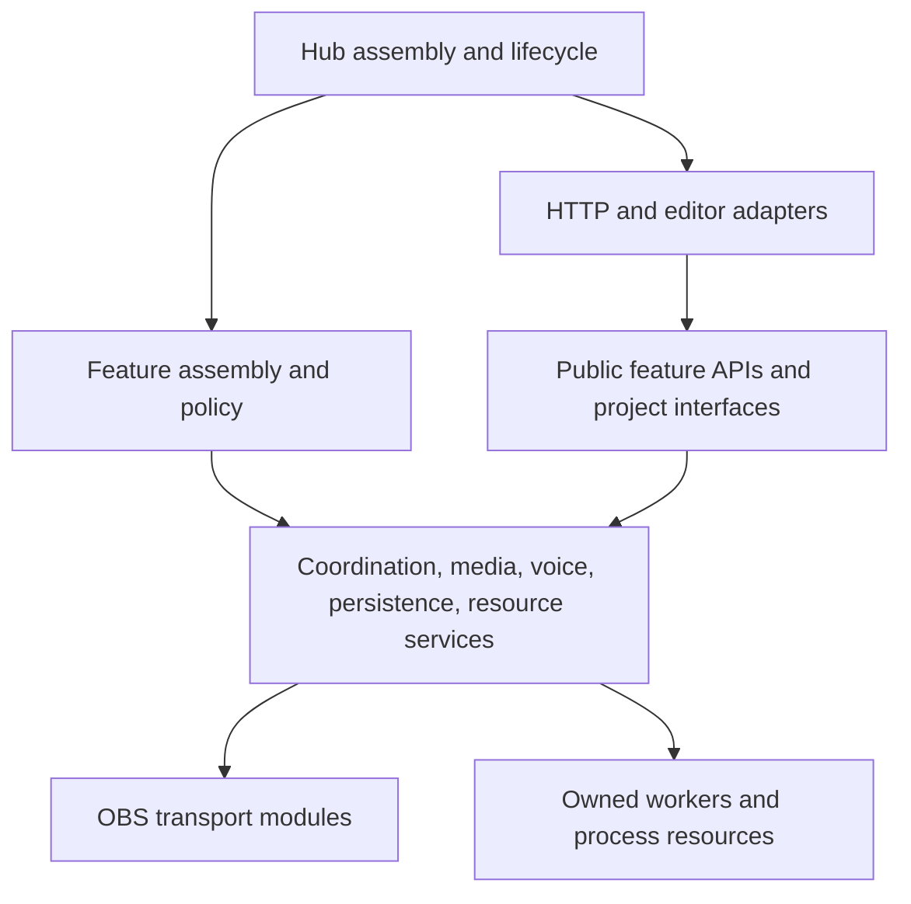

# Streaming Hub responsibilities

League Stats' `six_seven.py` owns exact live scoreboard discoveries (6 kills /
7 deaths, 67 CS, and either 6–7 team-score orientation). `Tracker.ingest` advances
it only after accepting a fresh verified match snapshot and emits
`chat.overlay.notice` outside its state lock. A per-match bounded seen set,
silent startup baseline and 12-second spacing reject repeats and stale intent;
no worker, settings write, historical scan or Twitch message is added.
The existing Hub event adapter forwards notices during its server lifetime.
Chat's `game_notices.js` owns a visibility-scoped SSE subscription, bounded
duplicate/age validation and plain-text emoji cards using normal chat trimming
and fading. Preview, hidden and disposed documents do not consume live notices.

League purchase celebrations live in `league_api/item_purchases.py`: bounded
1.25-second inventory/gold history infers paid additions without reusing evidence,
never a confirmed transaction. `purchase_recipes.py` owns validated item counts,
recursive component accounting, free transformations and known refund/discount
allowances. `purchase_ledger.py` owns at most 64 inferred purchase/sale receipts
for 120 seconds, balance-checked inverse operations and same-poll sale/purchase
accounting. Undo targets original cue identities; restored items never create a
new cue when matched to a reversal. Recipe consumption precedes reversal matching.
Engine supplies fresh local-player snapshots and game time; initial
baselines, reconnects, pause, match end and the shared League API permission gate
cancel stale presentations. A bounded FIFO supplies 2.8-second item performances
through the existing state endpoint. `production/web/purchases.js` owns one
finite canvas animation and one quiet audio element within the existing OBS
browser, with source visibility, transport expiry and teardown cleanup. Artwork
is served from the feature's local allowlisted cache. The finite maintenance
owner `tools/prepare_league_purchase_assets.py` prepares official Data Dragon
icons from the regional item version (or an explicit version) and an original
synthesized chime before gameplay; runtime never downloads
art or adds a game worker, listener, source controller or scene writer.

`lib/process_inventory.py` owns a lazy, immutable one-second process discovery
snapshot. Windows uses one Toolhelp process snapshot for names, parents and thread
counts; each native handle closes before publication. There is no new worker or
startup side effect. Diagnostics, desktop chat host discovery, League replay
observation and Spotify root discovery consume this shared mechanical contract.
Consumers retain PID-reuse/creation-time validation and their own feature policy.
Failures back off briefly and never publish partial or stale successful data.
Diagnostic thread counts follow discovery cadence, while CPU counters retain
sampling cadence. Chat readability uses the existing visibility-aware poller,
with cancellable deadlines and no hidden, page-exit or preview OS polling.

The four spirit habitats use independently composed `*-distinct-v4*.png` paintings.
`web/habitat-designs.js` owns their screen, camera, chat and foreground contours;
`tools/build_lobby_actions.mjs` exports the native `habitat-layouts.json` contract.
`camera-occlusion.js` restores only the painted prop below the authored torso
edge after aperture clearing, and yields completely to a custom camera rectangle.
The native foreground layers retain the full rectangular camera opening; the
browser paints the physical prop consistently for all four. `habitat-media-frame.js`
owns material-specific frames outside each 16:9 canvas. Hidden media removes its
frame. `broadcast-preview.js` supplies labelled local stand-ins only when a private
preview explicitly opts in; it never accesses real camera, chat, queue or media. Original
and intermediate plates and exact prompt manifests remain in the artwork owner.
`web/habitat-blocking.js` owns measured furniture contact points and bounded
surface admission; `habitat-acts.js` owns generated-pose choreography, contact
props and material reactions. `habitat-scenes.js` selects the four habitat casts
and finite environment events. Automatic visits share a surface exclusively and
admit at most two character stories; manual visits claim their own surface.
Stage retains its sole clock, aperture clearing and disposal. The removed forge
back shelf has no cached resident cast. `tools/test_lobby_habitats.cjs` verifies
visible movement, admission, resource disposal and captures contact/reaction
frames. Caption theatre is private opt-in (`preview=1&captions=1`); native rooms
carry their jokes in the paintings and physical visits.

The lobby festival refresh keeps the four active worlds in the existing artwork
and motion owners. Versioned `*-festival-v1.png` plates retain earlier originals
and saved apertures. `web/festival-copy.js` owns the bear/turtle/ram/phoenix
casting, authored jokes and questions, and deterministic 36-second slots with
23 seconds of content and 13 seconds clear. `festival-theater.js` finds a complete
unobstructed plaque position and yields to large manual effects; `festival-ink.js`
draws bounded miniature payoffs. `festival-weather.js` paints analytic distant
currents without particle queues. Stage supplies its existing clock, pause,
visibility, final aperture clearing and teardown; no new timer, service, audio,
setting or scene writer is added. The read-only browser review is
`tools/test_lobby_festival.cjs`.

The lobby feature's `web/league-guests.js` owns League casting and its finite
stance/poro/scuttler/Teemo performances; `league-acts.js` and
`league-spirit-ink.js` own choreography and drawn spirit effects.
`lobby-moments.js` adds scenic events and visitors anchored to the actual saved
screen rectangle, with physical shelf fallbacks when the display is hidden.
`spirit-weather.js` supplies bounded ambient motion without particle queues.
The existing stage clock and image owners retain all runtime resources.

Four curated rooms have versioned full-scenery paintings. `layouts.artwork` and
`layouts.foreground` publish the matching native backing and unchanged foreground
occlusion masks; browser rendering uses the same paintings. Originals remain.
`screen_content.visibility` reads actual nested media and parent visibility.
Its read-only HTTP adapter feeds `web/display-state.js` through the shared
visibility-aware poller: one cancellable request, no hidden polling or stale
response writes. The stage only clears the media aperture and paints its frame
when shown; camera and chat apertures always win. Scenery-only is an explicit
saved feature choice; shared `display_capture.apply_content` accepts a null
selection to hide just the published allowed references. Unknown overlays,
input filters, volumes, and per-world placements remain untouched.

The supported entry point is `Run Hub.bat` / `hub.py` in this checkout. Feature
packages own their policy and personal data. Shared infrastructure owns common
resources, admission, and coordination. Compatibility facades retain old imports
while implementation lives with its actual owner.

`lib/browser_effects/web/visible-poll.js` owns cancellable read-only presentation
polling, visibility and stale-response rejection. Existing Hub and League HTTP
owners serve that exact shared module; it owns no media or feature state.
Starting Soon and champion select stop requests while hidden and refresh upon
visibility. Feature renderers retain their own artwork and playback policy.
Shared sound-effect playback suspends invisible canvas work while retaining its
audio clock, channel heartbeat and completion acknowledgement. Visible return
draws the current audio position; a bounded startup yield cannot hang on a
suspended animation clock. Hiding the source never substitutes for audio pause.

## Dependency direction

Shared services do not import feature implementations. Feature peers communicate
through project interfaces, events, or shared provider contracts. HTTP feature
adapters are explicitly declared composition boundaries in the architecture
checker; they may import only the feature they expose.

Hub event transport (`hub_ui/updates.py`) accepts optional event-type filters on
the existing SSE subscription. Lobby documents request only their action cues;
unrequested statuses are neither encoded nor queued. Unfiltered Hub clients keep
the full feed, and workflow history sampling remains independent of subscribers.

Spotify's media observer retains track properties between metadata events, with
a five-second fallback read for missed notifications. Playback events still wake
immediately; a half-second status heartbeat preserves freshness. Revision checks
retain metadata changes arriving during an awaited read. No extra worker is added.
Its browser cancels animation callbacks while invisible but continues the musical
history on audio generations. Page exit aborts requests/deadlines and cancels
retry scheduling; restored pages reject older responses. Transport failures back
off from 250 ms to two seconds and recovery retains normal active cadence.

Spotify's `audio_articulation.py` owns causal held-partial, spectral-attack and
upper-register measurements from the existing FFT. The capture owner supplies
packet duration; the fixed mailbox carries complete frames with four additional
scalars. `music_articulation.js` owns bounded capture-clock gesture state, using
the same locked track gain as other amplitude features. `stage_articulation.js`
maps eight register envelopes to a continuous XYZ deformation and material field
inside the existing sculpture. Held partials bend its structure, attacks flex its
surfaces, and upper-register texture makes fine attached ripples. It emits no
additional geometry. Existing renderer/camera owners retain depth ordering and
GPU lifetime. There are no new workers, particle queues,
audio transforms or personal settings, and no singer/instrument classification.

Spotify's `music_dance.js` owns eight coupled torsion springs, pitch-direction
and stereo gestures, and a fixed 64-sample history per register. The existing
capture-clock motion owner advances it; geometry and the articulation field
only sample it. `stage_designs.js` owns six pure flowing ensembles with shared
hinges, paired curtain axes, attached braided tendrils and opposing/delayed
contour motion. Partner pull, depth clearance and smooth ribbon-width sampling
remain pure presentation policy in that owner. Together with the
six retained compositions in `stage_geometry.js`, these form the current twelve
stages. This adds no timer, worker, capture, output-volume write or personal setting.

Spotify's `audio_level.py` owns bounded visual-only playback-level compensation
on the existing capture worker. Float PCM avoids quantizing quiet playback before
analysis. A held RMS reference with a thirty-second release cancels constant
playback attenuation, preserves brief musical dips, and freezes during silence.
Large fader reductions settle gradually because captured PCM cannot distinguish
them from sustained quiet music. It adds no resource or output-volume writes.

`lib/audio_focus.py` is the scoped background-audio provider contract. Native
Soundboard, generic media (including TikTok and Sound Effects), and browser
effects acquire only for assets whose shared metadata probe confirms an audio
stream, immediately before source startup, and release after source cleanup.
`spotify/playback_control.py` owns reference-counted native Spotify pause intent
on the existing media-observation loop; it adds no worker, keyboard hook, session
manager or fallback timer. Restoration targets only the same paused session and
track after the final claim. Preexisting pauses, user resumes, stopped/replaced
sessions and changed tracks cannot be overwritten. Bounded admission removes
cancelled/expired claims before delayed observation; shutdown unregisters the
provider and releases owned pauses. Project pause controls still use the
coordinator and retain their existing overlay-visibility meaning. Metadata stores
audio presence with video dimensions in the same bounded cache; older derived
records are re-probed once without changing media or personal data.

Spotify's deterministic transition correspondence is prepared offline by
`tools/prepare_spotify_morphs.cjs`. The feature's `morph_assets.py` validates the
source fingerprint and retains one bounded server-lifetime payload; the existing
HTTP owner serves it. `web/morph_cache.js` owns the bounded complete browser map,
startup fetch, cancellation and page-lifetime release. Missing or stale assets
use the same live matcher, with reference geometry retained per family.
`stage_renderer.js` retains bounded command records, buffer views and the previous
depth order across paints, then sorts current depths with original insertion
order resolving ties. Audio simulation, geometry detail, shader work and browser
source settings retain their existing contracts. All GPU and CPU renderer storage
is released on disposal; these caches add no worker or independent frame clock.

Living-world owners pass their saved apertures to `PaintedPatch.draw` as optional
destination occlusions. Shared mesh mechanics skip triangles fully covered by a
later-cleared aperture, with a conservative seam/antialias margin. Deformed bounds
are checked each frame; layout policy, mesh detail and final aperture clearing
remain with the feature. The default draw contract remains unchanged.

League Stats' existing `collector.py` worker defers archive enrichment, history
imports, rank refresh and catalogue downloads during InProgress/Reconnect. Live
observations and chat handling retain their cadence; pending queues and manual
refresh intent survive until the phase leaves gameplay. The public enrichment
snapshot explains the deferral. No new game detector or worker is introduced.

League Stats' `recap_show.py` owns a revision-checked shared playhead and bounded
manual display intent, sampled by existing reads without a timer or worker.
`Tracker.control_postgame` assembles that policy with saved automatic-display
preferences. The public action is `postgame-control`; the HTTP route remains a
thin adapter. `recap_stories.py` derives covered personal comparisons, best
60-second personal takedown windows and confirmed lane gold leads. Presentation
selects four short visual stories rather than rotating raw metrics. The Hub
controller embeds the same page and explicitly disposes its iframe/resize observer;
OBS reads the same playhead. No scene write or additional OBS connection is added.

League Stats' `capture.py` retains bounded ten-second personal progression and
observed level changes on that same collector. `recap_events.py` projects only
personal combat, personal item/skill/vision events and both teams' objectives;
`timeline.py` supplies verified official evidence when available. The existing
transactional archive preserves these fields through enrichment and restart.
`postgame_report.py` owns coverage-aware Match Chronicle analysis, cached by
`Tracker.postgame_report` and exposed through the public API. Saved raw official
timelines can be projected without downloading or rewriting the archive.
`client_enrichment.py` verifies the end-screen player/game and projects local
client timelines on that same worker. `report_visuals.py` supplies personal build
and skill order plus measured own-team damage. `hub_ui/app/league-stats/postgame*`
owns the native 960 by 540 recap, responsive 640 by 360 layout, official Data Dragon
icons, automatic impact/build/timeline/stat pages and expanded details. It uses the
shared visibility-aware transport;
there is no extra gameplay worker. `obs_presentation.py` and the finite composition
tool `tools/install_league_postgame.py` add browser sources to the configured idle
scene and a dedicated review scene, preserving existing sources. Automatic display
requires the same recent match, a confirmed between-game client phase, and a
15-minute freshness window; lost transport hides the automatic report. Existing
League scene routing retains every program-scene decision.

`lib/browser_effects/presentations.py` publishes explicitly named feature artwork
during that feature's Hub lifetime. Identity tokens guard unregister; the shared
HTTP server serves original file bytes (including JSON manifests) and serializes
state API objects separately; it never imports feature renderers. `PlayCoordinator.request(...,
pause=names)` admits feature-owned pause policy under the actual ticket,
alongside saved rules, preserving newer intent precedence and completion ownership.

## Shared owners

| Responsibility | Owner | Contract and boundary |
| --- | --- | --- |
| Hub assembly and shutdown | `hub.py`, `main.py`, `lib/hub_runtime/` | Project startup/readiness, OBS-dependency partitioning via feature `REQUIRES_OBS` metadata, and joins live in `projects.py`; editor lifetime in `editor.py`; `outputs.py` starts the replay buffer once when OBS becomes available, respecting shutdown and later manual stops; services bind to the Hub stop signal |
| Discovery and instance ownership | `lib/project_registry.py`, `lib/single_instance.py` | Select supported projects and prevent duplicate Hubs |
| Native CPU pools | `lib/hub_runtime/resources.py` | Hub startup configures two-thread BLAS/OpenMP defaults after environment loading and before feature imports; explicit environment values win and subprocesses inherit them. Imports never change process policy; inference retains its existing explicit thread budget. The launcher checks dependency availability without initializing them twice. |
| Resource diagnostics | `lib/performance_monitor.py`, `lib/gpu_metrics.py` | Existing monitor owns sampling, rolling logs and one lazy NVML lifetime; direct read-only driver calls replace per-sample GPU subprocesses. Unsupported fields stay unknown. Driver failures release the handle and retry after 60 seconds; CLI fallback runs at most every five seconds with explicit sample age, including during media bursts. Monitor cleanup closes native and OBS handles independently; no extra worker or driver configuration. |
| Project controls/status | `lib/project_runtime.py`, `hub_actions.py` | Interfaces expose status, capabilities, and feature actions; shared manual pause/resume routes through the coordinator |
| Workflow discovery and review | `lib/workflow_map/source.py`, `catalog.py`, `validation.py`; owner-local `workflows.json` / `*.workflows.json` | Parse source without imports; feature owners describe their behavior; AST proofs flag changed explanations; proofs accept supported checkout module junctions only at their exact LOCALAPPDATA/StreamingHub/feature-packages home and reject nested escapes; current settings/rules refresh without rewriting personal data |
| Workflow observation and history | `events.observe`, `lib/workflow_map/journal.py`, `hub_ui/workflow_map.py` | Hub UI lifetime owns one bounded local SQLite writer; existing status poller samples public contracts even without a browser; observers enqueue promptly and cannot dispatch business actions; history excludes message/voice bodies and credentials |
| Published living-world ownership | `lib/workflow_map/source.py` | Static delivery does not transfer presentation ownership: `hub_ui/app/lobby-motion/` is a compiled mirror of scene_voice_switcher policy, while its `shared/` subtree mirrors public browser_effects mechanics. Both remain in their canonical owners' review scopes; the ordinary Hub scene-switcher page remains Hub-owned. Feature `web/stage.js` draws native OBS layers directly into the output canvas and clears all saved apertures; only standalone previews allocate the second full-frame compositing surface |
| Program-scene ownership | `lib/coordination/scenes.py` | Sole program-scene writer; serializes preparation/switching, revisions, manual choices, temporary leases, and latest deferred automatic intent; manual revision guards delayed workflows across owned temporary returns. Identity-scoped automatic holds defer preparation and retain only the newest valid destination; manual choices and temporary presentations remain available. Final release can resume that intent or discard it on shutdown |
| Scene handoff and observation | `lib/coordination/scene_session.py`, `scene_events.py` | Reserve before loading, scoped pauses, ownership-checked return; optional session transition is applied by SceneDirector for entry/return while preserving destination overrides and the global selector; one Hub event subscription detects outside switches and reconnects |
| Lobby presentation contract | `lib/coordination/lobbies.py`, `lobby_layout.py` | Feature-owned inventory publishes complete candidate and layer-data snapshots. Accepted scene transactions repair named layers before selecting a location; direct Hub and native OBS entries consume the same data. Published location groups resolve saved direct choices to their parent only after acceptance. Publication and repair share a presentation lock. The mechanical adapter snapshots before repairs, preserves personal source settings/filters and unowned overlays, and performs no program-scene writes. Missing links in scenes can be repaired; missing group children require the finite offline collection owner because WebSocket cannot insert them. It never starts another capture worker |
| Lobby display | `scene_voice_switcher/screen_content.py`; `lib/display_capture.py` | The feature owns Udyr/client/desktop/Chrome selection in lossless lobby preferences and publishes complete display data with its layouts. Shared mechanics only toggle allowed references inside Hub Display Capture; original input settings, filters, volumes, parent screen placements and unknown overlays remain intact. Test retains its gameplay capture. `screen_content.install` creates the independent unfiltered `Hub Lobby Udyr` input with the original media settings and current gain/mute, fits only its new display item, and retires only the original tilted input's nested display reference. The original input/filter chain and other scene placements remain intact. `tools/install_queue_presentation.py` installs the display off-stream and verifies unchanged program scene and original settings; no playback worker or program-scene write is added. |
| Cross-project playback admission | `lib/coordination/playback.py`, `pauses.py`, `serial_actions.py`, `rules.py` | Latest pending exclusive intent per project, request-specific completion, reference-counted pause claims, manual claims, and layered permission gates; callbacks schedule promptly |
| Cross-feature policy contracts | `lib/coordination/game_policy.py`, `lib/twitch_clip_session.py` | League publishes scene policy and complete image-clock match state; Twitch publishes clip-session availability; callers never read another feature's private state |
| Voice and keyboard | `voice/service.py`, `voice/listener.py`, `voice/ptt.py`, `voice/transcription.py`, `lib/global_hotkeys.py` | Optional upload word timing consumes the same model under its exclusive lease; one microphone/model lifetime and one keyboard child; feature adapters receive commands/keys |
| League kill audio | `mini projects/league/kill_audio_player.py` | Feature-owned selection and personal gain; one shared PlaybackWorker owns replacement through parking cleanup, follows the League permission gate, and leaves idle media hidden to prevent scene-entry replay |
| Physical media source ownership | `lib/shared_media/playback_worker.py`, `playback_controller.py` | One worker per source through cleanup; cancellation and one replaceable pending source request; layered sources remain separate |
| OBS asset presentation | `lib/shared_media/asset_playback.py`, `source_playback.py`, `source_audio.py`, `asset_layout.py`, `source_setup.py` | Source setup, load confirmation, audio application, layout selection, and asset capture/parking are separate components |
| Generic media assembly and controls | `lib/shared_media/media_project.py`, `interface.py`, `commands.py`, `runtime_settings.py` | Wire reusable components and trigger policy; no copied source controller in each generic feature |
| Profiles and inventory | `lib/shared_media/runtime_profiles.py`, `inventory.py`, `lib/snapshots.py` | Complete mapping generations for readers; profile activation/reload serialized; no clear/update window |
| Trigger windows and random selection | `lib/shared_media/trigger_window.py`, `random_mode.py`, `random_playlist.py` | Trigger winner/deadline, random-loop lifetime, and category/no-repeat selection are separate; random waits for admission and cleanup completion |
| Decoder startup | `lib/shared_media/media_startup.py` | Shared startup admission and real playback progress checks |
| Asset preparation and metadata | `lib/asset_preparation.py`, `lib/media_metadata.py` | One paced preparation worker and bounded shared metadata cache; one admitted probe, with cached reads independent of unrelated misses. `cpu_headroom.py` samples nonblocking CPU counters on that worker: optional probes/reads pause at 70% and resume below 55%, outside the decoder slot. Foreground playback bypasses this gate and shutdown interrupts waits. `media_metadata_store.py` validates and atomically persists at most 512 derived records / 2 MiB outside the checkout. Hub startup hydrates them before feature imports; exact path/size/mtime still gate reuse. Misses coalesce writes and the existing preparation worker flushes trailing changes; no unchanged writes or new worker. Persistence failures fall back to probes and never modify media or personal settings |
| Finite media conversions | `lib/media_jobs.py` | Weighted CPU budget, user-before-preview queue order, bounded FFmpeg threads, cancellation and child reaping |
| Persistence | `lib/json_store.py`, `lib/project_settings.py`, `lib/shared_media/profile_store.py` | Atomic unique temporary writes and shared in-process read/modify/write transactions; malformed personal files are preserved |
| Media review intent | `lib/media_review.py` | Read-only portable producer catalog `{clips: {id: {path, purpose}}}`; explicit replay-only files are excluded from automatic review, with legacy metadata and personal decisions preserved. Capture policy and classification writes remain in Instant Replay; Footage Desk composes the reader in `review_pool.py`. |
| Personalization and faders | `lib/settings_backups.py`, `lib/asset_fader.py`, `lib/shared_media/single_source_state.py`, `layout_rules.py`, `controls.py` | External history, loaded-asset level ownership, filters/transforms, per-asset placement precedence, latest project/profile/category/file offsets |
| OBS transport | `obs/client.py`, `containers.py`, `sources.py`, `animations.py`, `media.py`, `audio.py`, `outputs.py`, `scenes.py` | Connection, scene/group enumeration, inventory/transforms, animation, media transport, audio, outputs, and scene queries are separate; `interaction.py` is a compatibility facade. Container enumeration retries only a resource-type mismatch with the group getter and never caches collection inventory. The connection adapts SDK and raw current-program reads to the null-guarded scene-list query, preserving response fields and reporting missing program state as unavailable |
| HTTP transport | `hub_ui/server.py`, `hub_ui/routes/` | Dispatch, status/settings/audio/control routes and feature adapters; the Hub-owned HTTP server has a 64-slot accept queue for ES-module/asset bursts while its accept loop is busy. Song/replay APIs retain private runtime state in their features |
| Hub browser workspace | `hub_ui/app/js/app.js`, `nav.js`, `catalog.js`, `search.js`, `pages/` | Shell routing and searchable presentation catalog. Live desk is the picture-first stage editor; its components and ownership are described below. `desk-picker.js` retains scene, clip, song, sound and playlist operating dialogs for `pages/library.js`; `desk-controls.js` is its thin compatibility export. `discovery/catalog.js` owns purpose areas and deep links; `discovery/art.js` owns illustrative sketches. Explore your stream reads profile bindings lazily and issues no commands while browsing. `audio-workspace.js` assembles existing source/media level owners; `action-feedback.js` owns pending/error feedback. Workflow presentation lives in `workflow/atlas.js`, `workflow/map.js`, `workflow/behavior.js` and `pages/workflows.js`. Views release subscriptions and polls on unmount and reject stale async results; they do not own scenes, playback or personal settings. |
| File-response resources | `lib/http_files.py` | Existing HTTP owners authorize paths and supply policy headers; this stateless helper serves byte ranges in bounded chunks and releases handles on disconnect. Editor assets, replay previews, browser-effect audio and Twitch media share it. |
| Browser presentation | `lib/browser_effects/` | Server runtime, channels/sessions, OBS adapter and audio preparation remain separate. `session.py` owns complete playback revisions and one-second condition waits; playback mutations notify without waiting for browsers. HTTP adapts that public contract, and browser playback owns one cancellable request with a transport deadline and legacy fallback. `art/sound-scenes.js` assembles approved legacy/racing/muffin and raster-character owners, selected culture performances and remaining library owners. `culture-cues.js` owns the measured story dispatch; `sound-shorts.js`, `sound-romance.js` and `sound-encores.js` own the October 8 selected short cues, six romance acts and supporting prop payoffs across all 40 requested sounds; the dispatch also adapts measured visual cadence. `sound-signatures.js` owns semantic rim icons and single contour phrases; `sound-choreography.js` owns reconstructed rose grip, Cupid impact, hat return, fish contact and planted turns, shared with finite contact regression checks. `sound-encore-motion.js` owns finite throw, shoe stamp, level teacup, toast landing and mute-ping contact blocking. Supporting props enter after related acts and finite decoration settles after the payoff. `culture-party.js` and `culture-reactions.js` own individual subjects/choreography; `culture-sets.js` owns peripheral scenery; `culture-cameos.js` owns supporting jokes for preserved main shows. `sound-lineups.js` owns original-clip-second contacts shared by stamp, button, first Bonk impact, quack/cursor and meow shows; its finite paths consume the existing audio clock and never analyse audio live. `culture-contacts.js` owns cue-specific physical anchors for jumping, tripping, landing, clicking and catching, shared by the drawing owners and finite contact review. `culture-ink.js` supplies stateless native geometry and reads precomputed original-media envelopes from `culture-timing.json`, with no live audio analysis or clock. Earlier `playful-sound*.js` remains historical source; League retains its own playful owners and `playful-ink.js`. `cue-accents.js` and `library-accents.js` retain unselected cues. These compile into self-contained `web/rave.js`; `borders.js` owns the perimeter canvas. Playback/audio duration, channel identity and cleanup are unchanged. Twitch reads only public optical mechanics through its static adapter |
| Sound cultural-context review | `tools/review_sound_culture.py`, `tools/review_sound_culture.cjs`, `tools/test_sound_gags.cjs`, `tools/test_sound_story.cjs` | Standalone finite, read-only maintenance owners. Python extracts original video frames and PCM envelopes/cadence, and optionally reviews speech using one cached CPU model; it touches no microphone, original media, personal settings or Hub workers. Chromium reviews all exact hotkey members using original audio, full-resolution alpha and deterministic seeking, with a small live-frame monitor that does not impose full-canvas readback per frame. |
| Hooray confetti art | `lib/browser_effects/art/hooray.js` | Own bounded foil trajectories, streamers, poppers and perimeter ribbons; compiled into `web/rave.js` and selected by Soundboard's mapping through `web/renderers.js`. Draws sparse perimeter-only confetti and expressive poppers with native alpha using the existing audio clock, readiness and cleanup; original media and per-asset settings stay preserved |
| Border rendering mechanics | `lib/browser_effects/web/subtle.js` | Own the public mask, one-time sprite atlas decoding, safe edge placement, immutable edge-mask caching, material shading, atmospheric fields and fading light mechanics; subject geometry, palettes and composition stay in each presentation owner |
| Mom Frog presentation and preparation | `lib/browser_effects/art/mom-frog.js`; `tools/prepare_mom_frog.py` | The sound-cue owner composes three photographic views and pond-concert props using the existing audio clock and edge mask. The standalone maintenance tool owns finite denoising, external original-media backup and a recipe; it preserves the video, asset identity and saved gain. No runtime filter policy or new playback worker is added. |
| Random soundboard character borders | `lib/browser_effects/art/spam-cues.js`; `spam-ink.js`; `spam-{lizard,gary,quack,bonk,piuw}.js` | The dispatcher selects the five existing effects without owning hotkey selection or audio. Each performance owner composes its native three-pose raster cast and themed props; shared local paint helpers reuse the existing atlas decoder, audio clock and edge mask. `tools/review_spam_cues.cjs` owns finite isolated real-audio, transparency, motion and media-preservation QA. |
| Piuw/Frog audio and flowing borders | `art/piuw-border.js`, `art/frog-border.js` under `lib/browser_effects`; `tools/prepare_border_audio.py` | Visual owners add clock-driven plasma trails and flowing water/splash/croak waves without workers or timers. The standalone maintenance tool owns only the explicitly requested two-asset denoising policy, content-addressed external original/previous backups, candidate validation and atomic installation while idle; it preserves gain, asset identity and copied Frog video. Recipes allow reprocessing the original rather than repeatedly filtering a cleaned asset. |
| Short-cue timing and previews | `web/playback.js`, `web/borders.js`, `web/subtle.js` under `lib/browser_effects`; `tools/review_spam_cues.cjs`, `sound_preview_player.js/.css`, `test_sound_preview_timing.cjs` | Playback awaits artwork and a cleared warm-up frame before starting audio; current audio time and ended remain the only active clock/cutoff. BorderShow opts into 12-ms attack/18-ms release for cues under 1.5 seconds, leaving other presentations' fades unchanged. Finite exports distribute at least 60 frames/second across the exact original duration. Review controls stay outside the picture, share one encoded A/V clock, allow only one audible loop, freeze together on pause and clear one-shots on ended. Decoded-frame QA verifies visible onset, complete motion and millisecond A/V timestamp alignment. |
| Celebration border art | `mini projects/twitch_celebrations/art/` | `celebration-scenes.js` assembles native supporter/gift, raid and cheer performances into `raid_art.js`; local ink/prop helpers own only materials/silhouettes. The existing show owners supply elapsed time, text, custom media and cleanup. The four approved follower images belong to `spirit_assets/`, served by celebrations' HTTP allowlist, independently of transition-art cleanup. |
| Twitch rewards | `lib/twitch_redemptions/` | Service lifetime, transport, reward management, storage and playback engine stay separate |
| Twitch companion clips | `lib/twitch_clips.py`, `lib/twitch_clips_titles.py`, `lib/twitch_clip_session.py` | Highlight saves and moderator `!clip` share one 60-second creation and a 90-second global cooldown; bounded chat observers reuse pending/completed results without another POST. Shared transport verifies published duration and reports shorter clips without retries. Pure title policy uses save labels or channel title/category plus local date/time. Celebrations publishes authorization/stop and joins the worker at shutdown; command replies use the Hub sender. Review-later/replay-only captures remain local. |
| Twitch VOD/rewind settings check | `lib/twitch_stream_settings/` | Hub startup registers the service without opening Twitch or starting a worker; explicit Check settings runs the bounded check. Local Chrome extension enables exact dashboard switches and verifies persistence in the user's existing login; nonce-scoped status/retry API; successful acknowledged setup tabs close; no API credential or browser-cookie access |
| Resource diagnostics | `lib/performance_monitor.py`, `lib/process_metrics.py` | Existing shared polling and paced media-load sampling; process counters attribute Python/media CPU plus OBS browser and mux subprocesses without inspecting command lines; no feature-owned duplicate monitor |

`desk-sections.js` follows OBS ownership and public League configuration. It owns
stage browsing and contextual cues; `desk-appearance.js` owns unsaved gallery
choices. `desk-stage-map.js` presents Lobby/Queue as one view and clickable likely
next scenes; these call the same public feature actions as manual stage buttons.
League `ClientScenes` owns event identity for planning, bans, picks and loading:
each new event renews destination intent from any program scene, while unchanged
updates preserve manual choices. Result aliases share one idle event so lobby
rotation does not repeat. Director holds, temporary owners and revision guards
still gate scene writes; the dashboard never dispatches automatic scene changes.
`desk-session.js` owns explicit broadcast output controls, including the
End stream confirmation. `dashboard.js` assembles these with global sound effects
and read-only status polling. Art previews illustrate the selected scene rather
than showing live OBS output. The existing poll refreshes lobby inventory after
scene changes. Teardown rejects stale reads and removes dialogs.
`tools/test_stream_desk.cjs` covers scene observation, manual stage entry, lobby
effects, loading cues, holds, replay gating and broadcast confirmation.
`tools/test_hub_ui.cjs` covers image browsing/upload/apply, global effects,
navigation, source-level audio edits, stale responses and responsive layout.

## Feature responsibilities

The private effects gallery uses `hub_ui/routes/effects_gallery.py` for GET-only
resource transport. `effect_soundboard.py` and `effect_league.py` are explicit
read-only composition adapters to each feature's catalog, original media and
production settings. `pages/effects-gallery.js` owns one local preview clock,
audio element, renderer and cleanup. It never acknowledges live browser channels,
dispatches game events, writes settings or controls OBS. Renderer modules are
served from their canonical artwork owners; media requests resolve only catalog
stems and retain bounded range serving through `lib/http_files.py`.

Automatic jokes use `jokes.py` for live-only, revision-guarded random 20–40 minute
deadlines on the existing command module loop. `joke_catalog.py` validates the
personal `jokes.json` catalog and atomically reserves IDs in `joke_history.json`
before delivery, preventing repeats across restarts and retries of uncertain
writes. Offline/disconnected/disabled state and long sleep reset the deadline;
shutdown revokes queued messages. No extra timer thread or connection is added.
The public API provides an independent enabled switch and private list preview.
`twitch-jokes.js` uses the parent command page's polling/lifetime. Chat overlay
`joke_messages.js` recognizes only the configured broadcaster's `🃏 ` prefix,
keeps its text literal, and applies reduced ink/background and no arrival motion
while preserving the normal expiration owner. Viewer chat and command reminders
retain their own presentation.

Twitch chat commands live in `mini projects/twitch_commands/`: `settings.py` owns
personal command data, lossless atomic edits and optimistic revisions; `policy.py`
owns matching, permissions and response generation; `service.py` owns bounded
deduplication, alias-shared cooldowns and revision-guarded reply admission. `main.py`
registers one subscriber and releases it on shutdown. Replies reuse the Hub-owned
`lib/twitch_chat.reply` queue and existing Twitch authorization; the feature never
opens another chat socket or stores credentials. `api.py` exposes settings and
private previews, `hub_ui/routes/twitch_commands.py` is its declared HTTP
composition owner, and `pages/twitch-commands.js` presents the editable catalog.

`twitch_commands/announcements.py` owns the five-command rotation and random
30–60 minute deadlines. The existing module lifetime samples live OBS/chat
readiness and sleeps until its next check or deadline; no extra worker is added.
Selection proves enabled names through the same matcher/renderer, omits private
commands, labels roles, checks the shared clip-session availability and favors
least-recently shown entries. Offline, disable, edits and shutdown revoke/reset
intent. `lib/twitch_chat.announce` admits unthreaded messages to the same bounded
sender, authorization, expiry and pacing as replies; no uncertain write is retried.
The command editor owns the reminder switch and countdown presentation only.
Chat presentation `chat/command_guide.js` recognizes the broadcaster's explicit
guide prefix, rejecting foreign shared-chat context. The overlay renders a static
keyboard label and literal command text with reduced content/background opacity,
distinct from game/joke notices. It retains ordinary trim, moderation and aging
without another clock, poller or setting.

Channel presentation artwork is a standalone artifact owner in `stream_brand/`.

`stream_brand/easter_eggs/` owns the portable character-cameo artifact pack.
Its finite `prepare.cjs` preserves original sheets and extracts whole alpha
components; `v1/choreography.js` samples deterministic performances from a
caller-owned clock. The standalone gallery owns one visible animation loop and
releases decoded images on replacement/teardown. `export_frames.cjs` owns a
bounded loopback fixture and headless browser, closing both after finite exports.
`encode.py` uses the shared media-job budget for alpha-video exports and validates
decoded endpoints before packaging. This adds no Hub runtime, feature import,
OBS source, scene writer, personal setting or live lobby scheduling policy.
`catalog.js` owns authored copy, `design.html`/`.css`/`.js` own graphic layout,
and `tools/build_channel_brand.cjs` owns finite browser exports and visual checks.
`stream_brand/panels_v2/` owns the distinct image-led About card artwork and copy;
`tools/build_channel_panels.cjs` exports only that versioned panel family and
checks decoded artwork, text bounds and upload sizes. It cannot overwrite the
installed OBS cards or earlier panel assets and adds no live runtime.
`tools/install_channel_brand_obs.py` is the standalone maintenance owner for
additive native image scenes. It uses shared OBS transport, snapshots settings,
preserves existing source settings and placement on reruns, and never selects the
program scene. It is not imported by the Hub and adds no runtime service.
`stream_brand/trailer/timeline.py` validates authored cuts against actual media;
`soundtrack.py` owns its original synthesized score; `render.py` is a finite
standalone exporter over the shared media-job budget. It preserves original
footage and personal review metadata, renders on C: independently of replay
storage configuration, and verifies every delivery through a complete decode.

`stream_brand/intro/` owns the separate forty-second cinematic stream intro.
`timeline.py` owns beat-aligned v1 cuts and delivery validation; `story_timeline.py`
owns v2 combat choreography, pose groups and asset-specific visual metadata;
`continuity_timeline.py` owns the v3 opening spirit transformations and continuous
shield recovery, ram knockdown and grounded-villain phoenix sequence;
`cinema.py` owns
the offline art, alpha-layer, approximate depth, typography and atmosphere renderer;
`audio.py` owns source-excerpt analysis and original procedural effects; `render.py`
owns one finite renderer/encoder lifetime through the shared media-job budget,
source fingerprints and full-decode delivery validation. Generated art and media
stay on C: because F: is full. This package has no Hub startup registration,
OBS writes, settings changes, listeners or publishing behavior.

`stream_brand/sketch_journey/` owns the separate inexpensive concept animatics.
`choreography.py` owns its beat-aligned journey and continuous character poses;
`paint.py` owns original stick figures, animal outlines and sketched landmarks;
`escape_choreography.py` owns the sanctuary awakening, persistent obstacle states
and continuous escape poses; `escape_paint.py` owns the sanctuary drawings,
body-worn spirit envelopes, masonry impacts and celestial destination reveal;
`cinematic_timeline.py` owns the v3 shot sequence, world positions and camera
intent; `sketch_space.py` owns local perspective projection and near-plane clipping;
`cinematic_paint.py` owns circular-room pencil geometry, branching spirit lights,
subjective spirit anatomy, rescue close-ups, phoenix storm and seated vista;
`illustrated_timeline.py` owns the v4 single-entrance escape, return to the same
island and interior camera positions; `illustrated_materials.py` owns filled
facets and the local depth buffer; `illustrated_paint.py` owns the continuously
animated colour concept, body-worn spirit forms and full entrance cave-in;
`motion_timeline.py` owns the v5 anticipation, build, contact and recovery clocks
and camera continuity; `motion_rig.py` owns fixed-length world and POV limbs and
planted gait; `motion_effects.py` owns progressive energy travel, claw strikes
and contact-driven debris; `motion_paint.py` owns the textured rig-based concept;
`motion_audio.py` owns finite original contact-effect synthesis and the
artifact mix, preserving the music-only export and unchanged source audio;
`art_timeline.py` owns the cinematic-art opening camera, center-born light and
immediate claw-triggered collapse; `art_assets.py` explicitly loads unchanged
generated PNGs; `art_materials.py` supplies perspective-correct UV and alpha
samples through the existing local depth-buffer contract; `art_effects.py` owns
outward surface illumination and collapse accents; `art_paint.py` composes the
painted world, connected character rig, gateway and articulated spirit cards.
The art pass is a standalone finite artifact and adds no Hub runtime resources.
`motion_review.py` owns reusable finite movie decoding, frame extraction, rig
and audio audits; `art_review.py` owns the art pass's targeted review frames,
asset-preservation evidence and versioned delivery archives.
`render.py` owns the finite lightweight export and full decoding checks through
the existing media-job budget. It references lobby artwork without modifying it.

`stream_brand/spirit_slideshow/` owns the separate forty-second illustrated
comparison. `timeline.py` validates distinct generated PNGs, complete coverage
and frame-quantized cuts; `presentation.py` builds portable image browsing and
contact sheets; `render.py` owns the finite still encoder and supplied-music mix
through the shared media-job budget. `review.py` verifies every encoded picture,
unchanged held frames, original PNG/music fingerprints, and versioned archives.
Versioned `v2/` assets and plans own the expanded spirit transformations and
bridge-collapse story. `analyze_music.py` runs finite source-excerpt analysis;
authored cue records distinguish selected music attacks from intermediate cuts.
Versioned `v3/` owns the calmer shot selection. `calm.py` encodes bounded two-image
stationary segments with short opacity dissolves and restrained video highlights;
`comfort_review.py` checks encoded blend progress, stable holds, original media,
audio alignment and pixel-change comparisons. Those measurements do not certify
viewer comfort. Both use the existing finite media-job budget.
It adds no live Hub resources, settings edits, OBS writes or 3D renderer.
Versioned `v4/` owns six generated ram-action paintings and the corrected
causality: first-person horn contact breaks the wall, reveals an already missing
bridge span, and retained charge momentum causes the fall. Four selected
first-person pictures hold 1.6 to 2 seconds, removing the extra edge insert and
exterior cut; music is a replaceable placeholder. All other v3 paintings and
their cut times are preserved. `review.py` resolves original generated PNGs
through nested version provenance; `comfort_review.py` uses that same contract
to verify originals across generation sessions.

The authored Spirit Afterparty lobby lives at `hub_ui/app/spirit-lobby/` and uses
existing Hub HTTP transport. This project directory is a junction to
`C:/StreamingMedia/SpiritLobby/2026-10-03/web` because the media drive filled up.
Static transport authorizes that artifact's resolved root separately; all other
static paths retain their original containment boundary. `room.js` loads the
original clubhouse plate without the desktop display; `props.js` owns the booth, speakers and display
assembly. `surfaces.js` owns panel geometry/perspective, and `text-screens.js`
caches flat typography before projection. `penguin.js` owns the 3.8-second paired
emote sequence, alternating wave slots, pose blends, periodic recoloring and one
whole-character opacity pass; `sprite-paths.js` decodes unchanged classic frames.
`fractal-galaxy.js` owns an unbounded nested-system journey with at most eight
cached textures. `projection.js` assembles built-in programs. `screen-content.js`
owns one cancellable catalog refresh, at most three active sign/booth media slots, silent looping
video, pause/hide behavior and complete document cleanup. `scene.js` owns one
frame-capped animation loop. The foreground keeps the booth in front of the
existing shared Parsec camera. The background remains painted behind keyed video
and transparent chat; only foreground apertures protect them from accents. The
removed main display allocates no media and its saved library choice is retained.
Afterparty's layout plan hides its desktop link and retains all other lobby screens.
`screen-studio.js` owns media-import and sign/booth authoring UI;
`studio.js` encodes optional overrides as paired URLs.

`celebration.js` owns a bounded collection of independent finite accents and
queued alternating waves. Particle, prop and botanical drawing live in the
`party-*` artist modules; they own no workers or external resources.
`party-studio.js` owns the action controls. `action-link.js` owns one visible
document's existing Hub SSE subscription and up to eight cancellable requests;
hide and teardown close them. `spirit_lobby/actions.py` validates the canonical
action catalog and creates stateless cue envelopes. The HTTP adapter publishes
those cues through `hub_ui.updates.broadcast`; it adds no event bus, playback
worker or OBS controller. Each browser admits cues independently, deduplicates
the local preview/server echo, rejects stale delivery, expires finished accents
and rejects excess new work without cancelling accepted animations.
`party-director.js` owns autonomous choreography in that same document frame
loop. Deterministic wall-clock phrases let both OBS layers join the same ongoing
party despite different paint costs. Weighted novelty, small companion entrances
and soft visual pressure vary pace and overlap, with manual cues reducing new
automatic activity. The director scales cadence with motion speed, caches at most
four phrases and 256 attempt identities, and adds no timers, services, SSE cues
or persistence. Defaults enable a lively party; paired URLs carry the chosen
gentle/lively/wild/manual-only rhythm. The new floater, guest and spark artist
modules keep their finite drawing responsibilities separate from scheduling.

The public `spirit_lobby/library.py` feature owns display selections, text, format
validation, bounded imports, preserved originals, C: media storage, external
history and atomic complete catalog publication. Its constructor/imports have no
side effects or workers. `hub_ui/routes/spirit_lobby.py` only adapts HTTP to that
public owner and reuses shared file-range transport. It adds no server, hooks,
decoder workers, audio or program-scene writes. Workflow discovery explicitly
includes this owner. `tools/install_spirit_lobby_obs.py` remains the additive
maintenance owner for OBS scene assembly and preserves personalized reruns.
Browser/HTTP QA uses a disposable library; native QA checks camera, scene,
source/filter and fader preservation without selecting program.

`tools/organize_obs_collection.py` owns finite, offline collection organization.
It requires a complete duplicate rollback collection, carries source UUIDs,
children, filters, audio, hotkeys and unknown fields into groups, rejects nested
groups and bound scene shortcuts, and archives only unreferenced named QA scenes.
It shares compatible unfiltered HUD monitor inputs without changing their saved
settings; hidden retirement references retain their original personal filters.
This is a standalone maintenance owner, never imported by the Hub. See
`docs/OBS-ORGANIZATION.md` for the installed structure and paired rollback.

Starting Soon owns waiting-room policy in `mini projects/starting_soon/service.py`,
including rotation only while its scene session is active. Idle ticks do no
settings/catalog work; queued controls still wake immediately. Its public status
and workflow snapshots bypass editor catalogs and queue/history copies; player
status reports the same worker and permission gate. Editor artwork availability
and labels come from one catalog scan.
Personal configuration and named playlists live in `settings.py`, atomic per-clip
levels in `levels.py`, dedicated OBS sources in `presentation.py`, and one source
worker in `player.py`. `opening.py` owns the approved Sanctuary opening on that
same worker: wait for cleanup, temporarily use full-canvas placement, restore the
exact personal transform, then hand off through the scene-switcher public interface
with the captured manual revision. A newer scene choice cancels the return; decoder
failure returns to Starting Soon and exposes the error. It starts no extra worker. `queue_state.py` owns the editable live queue separately
from saved playlists; `layouts.py` owns validated placement and per-asset precedence;
  `artwork.py` owns the artwork catalog. `looks.py` validates reusable visual presets;
  browser `world-deck.js` owns two bounded image layers, reveal cancellation and drift,
  pausing motion while the source is invisible. The overlay owns separate artwork,
  message and frame presentation, memoizes the displayed fields to avoid unchanged
  DOM/layout work, and cancels its bounded request and polling on exit. The
  production desk saves visual looks without changing playlists, asset placements
  or levels, and disabling highlights cancels the existing clip worker.
  Its persistent temporary `SceneSession` prevents automatic game
routing from interrupting the waiting room and releases only its own pause claims.
`clip_library.py` consumes Instant Replay's public `clip_catalog()` and
`clip_selection(paths)` project-interface contract, preserving replay inventory,
titles, validation and existing asset levels in their owner. The HTTP composition
adapter `hub_ui/routes/starting_soon.py` exposes only this feature's public API.
The Hub browser page assembles separate playlist, library/private-preview and
appearance editors. Private previews reuse Instant Replay's public preview
transport. The OBS browser overlay owns visual crossfades, responsive canvas
scaling and recorded-footage labels, following the native source's placement.
`presentation.py` migrates the native item into a dedicated nested OBS stage,
carrying its full transform and retaining the original hidden item. This keeps
placement and visibility live when Studio Mode duplicates the parent scene.
Message visibility and scenery captions are personal settings owned by the
feature. Its public show/hide-message actions support future control schemes.
The overlay exposes full, artwork-only and transparent message-only render modes;
the Hub appearance editor provides reusable URLs and original text-free PNG links.

| Feature | Internal responsibilities |
| --- | --- |
| Desktop chat overlay | `lib/chat_overlay/settings.py` owns independent transactional personal preferences; `catalog.py` owns provider parsing and bounded catalog requests; `desktop.py` owns configuration/activation of the installed transparent host; `pointer.py` reads native cursor/window state without hooks or workers; `startup.py` owns one optional, bounded launch attempt after the Hub HTTP ready signal and joins on shutdown; `sticker_pack.py` owns finite authored vocabulary additions; `chaos_pack.py` owns selection, transactional persistence and public catalog composition for the local animated library in `chat_sticker_pack.json`; `tools/build_chat_chaos_pack.py` is its finite maintenance installer from captured public metadata. `hub_ui/routes/chat.py` exposes these public contracts. Browser `overlay.js` applies saved typography/message density and bounds the message list; `message_lifetime.js` owns one browser animation per retained message, configurable full-visibility hold followed by linear whole-message aging and expiry on the existing sweep, cancellation on removal, and saved-lifetime updates without restarting unchanged fades (lobby chat stays persistent); `protocol.js` parses Twitch tags, `stickers.js` owns phrase matching, `readability.js` owns content-only hover/desktop clarity, and `sticker_studio.js` presents the searchable, paged library with viewport-limited thumbnail animation, offscreen/hidden cleanup and local hover previews. Hover never changes cards, geometry, focus or click-through. |
| Spirit transitions | `lib/scene_transitions/web/rig.js` and `mesh.js` own continuous painted-surface mechanics and explicit atlas overrides; per-animal `rigs/` modules own gritty anatomy, deterministic acting and projected contacts. `rigs/bear/art.js` selects quadruped paint and bounds its view buffers; `bear/calibration.js` owns landmarks and fixed bones; `bear/motion.js` owns gait/support and paw paths; `bear/skin.js` owns joint-based paint/wrist orientation; `bear/turn.js` registers yaw views; `bear/front-motion.js` owns complete frontal view weights, lens-pressure projection and claw coordinates; `bear/front-paint.js` owns intact frontal paint and bounded blend buffers. `bear/presentation.js` composes depth and complete view blends. `web/bear/approach.js` owns shared world placement, `web/bear/tears.js` owns persistent per-strike cover geometry, and `web/bear.js` owns foreground performer staging; the renderer provides an optional foreground composition hook after masked coverage. Bear public facades stay thin. Turtle art/calibration/motion/skin/presentation live in `rigs/turtle/`, owning one intact painting, source-registered body/four-limb regions, bounded paint generation, diagonal planted crawl and exact source-root binding; turtle/joints.js owns the two-bone knee solve, skin.js follows upper/lower segments and rigid claw pads with a connected shoulder socket; `web/turtle/projectiles.js` owns the three rocks and destruction, `shield.js` owns defense timing and solid coverage, `dome.js` owns rough jade-stone facets, irregular rim and bounded jade/gold current optics, and `turtle_sound.py` owns its finite soundtrack. Turtle public facades and choreography assembly stay thin. Ram skin selection/crops/material belong to rigs/ram/skin-pack.json; ram/art.js owns complete bounded painted generations; calibration.js owns thirteen-view UV anatomy; views.js owns named pose contracts; leaps.js owns parabolic bounds and complete crouch/push/tuck/reach phases; turn.js owns planted true-back yaw and the frontal rear/fall sequence; motion.js assembles world trajectory, facing and continuous pitch. joints.js and skin.js own articulated tissue, rigid hooves and a bounded local head/neck registration field; registration.js preserves early native body proportions and late horn/ground registration; presentation.js owns far/body/near and whole-view composition. web/ram/stage.js, impact.js and reveal.js own staging, golden-stone coverage and plate release; ram_sound.py owns finite synchronized sound. Ram public facades stay thin. `rigs/phoenix/art.js` owns four camera views, two wing surfaces, isolated talon/tail paint and bounded generation buffers; `anatomy.js` owns measured ratios and UV mounts; `motion.js` owns yaw, feather lag and talon acting; `projection.js` owns the shared painted mount/contact geometry and fixed leg bones; `paint.js` owns depth layering and premultiplied view/surface blends. `web/phoenix/flight.js` owns world trajectories, `entrance.js` rebirth props/flight accents, `storm.js` material flow and ash optics, `veil.js` solid wing-origin coverage/erosion, and `palette.js` cold-fire/ember colors. `phoenix_sound.py` owns finite synchronized sound generation. Phoenix and flame compatibility facades stay thin. `characters.js` dispatches complete painted asset generations and releases replaced resources; `renderer.js` rejects stale loads. `web/performance.js` owns continuous trajectories; per-animal choreography owns contact-driven cover/reveal; catalog/timing own eight performances and safe cut metadata. Native OBS owns fixed media children, shuffled selection, alternating performances and playback-clock cuts. HTTP only serves preview assets. `installation.py` owns pure collection patch policy; finite export/install/QA adapters preserve unrelated data and never launch OBS for closed-OBS updates. |
| Soundboard | `main.py` wires profiles, commands and triggers and registers a runtime asset catalog/selection provider with bounded cleanup; `desk.py` owns manual selection policy, and `interface.py` exposes `asset_catalog()` / `play_asset(source)` to the generic HTTP project adapter. Desk selection uses the same admitted playback path and current per-asset settings as keys/voice, stopping its random mode first. `player.py` adapts its OBS/browser presentation to shared source workers and coordination gates |
| Specific Song | `commands.py` interprets controls/categories; `library.py` loads aliases/bindings; `matcher.py` ranks; `player.py` owns song presentation; `api.py` exposes library/commands; `main.py` assembles |
| Instant Replay | `capture.py` owns independent highlight/replay-only/review-later captures and save results; `inventory.py` owns one fresh filesystem inventory for runtime and offline management, including tags and linked raw-copy suppression; `lib/file_inventory.py` supplies scoped directory metadata snapshots without a retained cache or watcher, reused for filtering, sorting and UI sizes; `selection.py` owns candidate selection and one cancellable save continuation; `playback.py` owns presentation through final cleanup; `source_playback.py` prepares the hidden decoder, waits for a settled first frame and holds it through entry or clip reveal; `presentation.py` owns pure mode/copy/viewport policy; `stage_settings.py` owns personal presentation preferences; `stage.py` publishes complete stage/capture/progress snapshots, reconciles current labels after library edits and owns revision-scoped cover/reveal acknowledgments with bounded native fallback; `obs_stage.py` owns dedicated backdrop/motion/matte inputs and scene-item references to existing capture/camera sources; browser `replay-stage/clip-transition.js` renders finite viewport-only handoffs without controlling playback; `audio.py` restores desktop audio; `editing.py` owns saved cuts; `trimming.py` handles capture cuts; `library.py` owns atomic metadata, independent capture purpose/review decisions, eligibility and archived aliases; `runtime_state.py` owns the feature handshake; `api.py` exposes controls; `main.py` wires lifecycle |
| League API | `service.py` owns runtime services; `client_scenes.py` chooses client-phase and configurable between-games policy once per transition, guards delayed intent and preserves newer scene choices; `scene_routing.py` prepares and requests presentation through the director; shared game policy exposes automatic-lobby/hold decisions |
| League events | Interpret game events and production presentation; Live Client traffic shares `lib/league_live_client.py`; production borders use public interface capabilities |
| League gameplay HUD | `league/core/match_lifecycle.py` gates gameplay on a positive live timer and latches cumulative GameEnd evidence across reconnects; `league/hud_presentation.py` alone owns nested map/HUD and alive-only Udyr visibility. Separate HUD groups retain independent crops/masks over one shared HUD capture; `ScreenCaptureMAPHUD` remains their reusable nested parent. `tools/align_league_hud.py` is the finite, settings-snapshotted OBS calibration owner and supports both scene and group containers. |
| Udyr stance loops | `league/udyr_stances.py` owns accepted stance intent and the existing `UdyrImageMaskANIMATION` input through one `PlaybackWorker`. `udyr_casts.py` owns bounded Q/W/E/R-to-mana evidence, conservative observed-regeneration correction, expiry and a five-second fallback guard after each Enter press. Outside the guard, ambiguous keys switch immediately; inside it, spending at least one mana accepts the latest candidate. Ignored chat presses never replay on guard expiry. League's existing keyboard subscription supplies candidates; its existing watcher observes at 250 ms during gameplay through the unchanged shared cache (at most four HTTP snapshots/sec). HUD match/alive observations gate both. Repeated selected stances do not restart, respawn retains the stance, and a new match defaults to blue. Replacement waits for cleanup, stale work is discarded, playback follows the League permission gate, and shutdown waits for cleanup. Filters, placement, audio settings, lobby inputs and program scenes retain their existing owners. `tools/prepare_udyr_stances.py` is the finite original-footage matching/blending exporter using the shared media-job budget; versioned clips and provenance live at `C:/StreamingMedia/UdyrStances/v1`. |
| Udyr side accent | `league_api/production/stance_accent.py` owns one expiring cue through a startup-scoped `league.udyr_stance` subscription. The producer emits after changed stance media begins allowed playback. Existing production snapshots gate the cue on gameplay, death, match artwork, enabled borders and module permission. `production/web/stance-accent.js` prepaints four 32 by 560 canvas tiles, retained for the page lifetime (280 KiB raw pixels) and released on page exit. The existing production frame clock draws two narrow side strips for 1.2 seconds at 6.5% peak alpha before saved strength, with no per-cast canvas, decoder, particle queue, network request or timer. |
| League border art | `production/web/scene.js` owns composition, saved opacity and clear gameplay center; `event-art.js` owns dispatch/envelopes. Canonical `art/event-scenes.js` compiles to `web/event-relics.js`. All 58 finite events have distinct compositions in `border-{combat,dragons,objectives,structures,vitals,progression,lifecycle,signals}.js`; `border-scenery.js` / `border-signal-scenery.js` stage asymmetric materials. `border-ink.js` / `border-materials.js` are pure geometry and optics; `border-contacts.js` owns actual contact coordinates; `border-scores.js` dispatches; `border-stories.js` is preview copy. Only main titles and functional death timer are rendered. `art/BORDER-DESIGN.md` records detector limits, research and each visual process. Existing `story-ink.js` maps finite action into 74% of personal duration. Earlier story owners retain sustained drake habitats; Hextech ambience remains in `web/elements.js`. `border-vitals.js` owns sustained death on its real clock. No renderer detects events or starts resources. `match-screens.js` retains original pictures, deadline precedence and finite visible paint lifecycle. Source/document visibility rejects expired presentations. Shared `subtle.js` remains a public mechanical dependency. |
| Twitch celebration art | `overlay.js` owns the browser clock and cleanup; `supporter_show.js` owns preserved follower/gift presentations and delegates subscriptions to `subscriber_party.js`. `subscriber_story.js` owns month milestones and shared coin/heart contacts; `subscriber_acts.js` owns wordless thank-you gags. The existing pose cache, audio element and RAF are reused; `tools/prepare_subscriber_music.py` prepares the original finite musical sting; `cheer_show.js` owns Bit worlds and custom visuals. `raid_party.js` composes one canvas with the guaranteed transparent gameplay opening. `raid_score.json` owns measured music cuts, beat anchors and exact queue/preview durations; `raid_music.js` maps the owned audio position into smooth story time. `tools/prepare_raid_music.py` makes finite non-looping copies of existing tracks. `raid_story.js` owns finite act windows and trajectories; `raid_acts.js` owns individual character setups/interactions/payoffs; `raid_effects.js` owns bounded border stagecraft. `raid_cast.js` draws articulated puppets; `raid_penguins.js` owns the penguin pose cache. `raid_guests.js` owns 24 feature-local copies of the user-generated lobby poses; `raid_crossovers.js` owns finite multi-character interactions and shared prop/contact trajectories. The finite maintenance tool `tools/prepare_raid_guests.py` copies artwork with hash verification and never imports peer runtime code. `raid_sequence.js` owns announcement/name fitting, cue audio and release. Local penguin copies preserve ending-screen originals without peer imports. `raid_art.js` retains legacy scenic artwork, unused by current raids. All use existing event transport, queue and audio controls. |
| League Stats | `normalize.py` interprets live/post-game evidence and reported roles; `timeline.py` interprets official checkpoints and purchase events; `collector.py` owns one bounded polling/history worker over existing League transports; `riot.py` owns credential refresh, verified public identity and read-only Riot transport/budgets; `enrichment.py` owns bounded resumable archive enrichment; `ranked.py` owns persisted observed ladder movement; `presentation.py` owns recap, recent form, live target pace, account labels and coverage; `audience.py` owns evidence for current-lane and lifetime viewer questions; `service.py` owns reconciliation and assembly; `observations.py` owns audited helper-counter policy; `management.py` owns saved sessions and reversible review policy; `community.py` owns bounded viewer stat requests; `chat_replies.py` owns concise Twitch copy and local previews; `store.py` owns the transactional external archive; `analytics.py` owns coverage-aware summaries and `insights.py` derives performance, records and trends; `api.py` is the public HTTP/project contract. Viewer overlays request a compact snapshot with no archive tables or editor previews; hidden overlays cancel polling and fetch current state on return. Export bypasses presentation calculation |
| Scene voice switcher | `commands.py` owns pure matching; `layouts.py` owns artwork, apertures and legacy aliases; `settings.py` owns lossless rotation/placement preferences; `presentation.py` publishes authored layer data and repairs through shared mechanics; each active chat viewport uses its board dimensions, with inactive browsers shut down. `inventory.py` discovers groups/nested scenes and the existing Spirit Afterparty, publishing complete layer plans, rotation and exclusions; `routing.py` owns director requests; `api.py` exposes gallery, configuration, installed presentation destinations, current-world effects and repair controls; `main.py` owns one command/event/hold loop and catalog lifetime. Rejected/stale requests never prepare visibility; direct Hub/native OBS entries repair published layers without another scene writer. The gallery provides current-location feedback, search, per-world rotation/placement, and explicit entry with desktop visible; Live desk uses the same labeled catalog. Lobby browser mode reuses the chat transport/channel with full-opacity, persistent messages without changing desktop preferences. `passages.lua` owns the installed OBS-lifetime native item handoffs and one frontend subscription, released on unload, with no worker/socket/timer; it preserves personal transitions. `passage_installation.py` owns pure script-entry policy; `tools/install_lobby_passages.py` is the finite off-air collection adapter, while `verify_lobby_passages.py` owns finite native QA through SceneSession. Neither installer nor Lua writes program scenes |
| Sound effects / TikTok | Feature configuration and trigger policy over the generic media components |
| Living lobby artwork | `scene_voice_switcher/motion.py` and `web/reef-*.js`, `stage.js`, `studio.js` | Eleven authored worlds (Reef, Forge, Sanctuary, Sky Harbor, Storm Coast, Phoenix Observatory, Spirit Railway, Tavern, Future Lounge, Spirit Arcade and Aurora Camp) animate cached regions of their original paintings and admit finite thematic visitors with soft pressure and novelty weighting. worlds.js loads the chosen world; each world owns landmarks, atmosphere and guest performances. painted-world.js shares decoded-art assembly within this feature; five redesigned worlds optionally paint versioned full artwork through their existing living layer before the same complete saved apertures are cleared. chaos-cast.js assembles their setup/payoff choreography and chaos-ink.js their comic props. lobby-residents.js owns three connected-alpha sprite caches per redesigned world and continuous room routines; lobby-cameos.js supplies finite painted-character performances through PaintedWorld.drawVisitor. Residents vacate their perches while participating in a cameo. `visitor-staging.js` owns per-cue environmental anchors, whole-act scale and background selection weighting for all eleven worlds; resident perches use small silhouettes and contact gestures. Dynamic captions are removed from artists, with invitation labels kept in the studio. Decode, pause and teardown share the existing presentation lifetime. Original OBS image settings and files are retained, and the studio replaces one iframe when the selected world changes. Feature policy supplies cast, landmarks, saved apertures and choreography. Public `lib/browser_effects/web/world-motion.js` supplies only bounded scheduling and cached triangle-mesh mechanics. Each patch retains fixed topology/source coefficients and reuses projected coordinates; disposal releases all mesh buffers with its canvas. `effects.py` owns validated world-specific action envelopes and generated metadata. `web/live-actions.js` subscribes through the existing Hub SSE transport only in a visible native document, rejects stale/wrong-world/duplicate cues with bounded history, and closes on hiding or teardown. Private previews never subscribe. The stage owns one visible-document loop and tears down instances and canvases; complete screen/camera/chat apertures are cleared after all accents. The optional published layer follows the original foreground, or the camera in flat paintings, and precedes dedicated chat; native OBS shuts it down while inactive. `tools/build_lobby_motion.py` owns finite provenance-preserving static publication; `tools/build_lobby_actions.mjs` is the standalone finite metadata exporter from actual authored artists, with no OBS or settings writes; `install_lobby_motion.py` owns finite off-air installation and preservation checks. Original art, personal inputs, filters and placements survive. No new Hub worker, socket, keyboard hook or scene writer is introduced; the existing Spirit Afterparty retains its own automatic party renderer |
| Mood cues / Love Me | `love_me/catalog.py` and `score.py` own authored directions and editable file-time word cues; `montage_catalog.py` owns the cinematic still selection and provenance; `assets.py` publishes explicit mood-owned C: image/font files, installed by the finite maintenance owners `tools/install_signal_assets.py`, `tools/install_mood_montage.py` and `tools/install_mood_fonts.py`; `web/montage.js` owns full-frame cover layout, an independent saved file-time musical-hit entrance, a non-repeating file-clock cut sequence starting immediately on the hit, compensated crossfades and closing transparency; `web/signal.js` owns larger typeface cycling and held-word fading; `web/type-ink.js` owns bounded worn glyph rendering; `settings.py` owns lossless variations/audio imports; `service.py` serializes original stages and repeat sessions on one worker; `presentation.py` owns asset faders, routing and ID-scoped browser cleanup. `main.py` owns one keyboard subscription and a bounded intent queue. `api.py`/`interface.py` expose public controls; `hub_ui/routes/mood_cues.py` is the declared HTTP adapter and `pages/mood-cues.js` owns the private editor/preview. Original assets and `987` remain intact. |
| Twitch celebrations | `main.py` owns Hub assembly and shutdown, `service.py` owns synchronized queue/settings and one-second condition waits, `obs_source.py` owns source attachment. Idle browsers wait for event/control notifications with bounded requests; settings transactions preserve unknown external fields. Legacy polling and active show cadence remain supported. |
| Spotify | Spotify's `audio_texture.py` owns a bounded salient-partial roughness proxy from the existing FFT; `audio_analysis.py` owns fixed-gain waveform and unsaturated full-window presence, absolute-range spectral measurements, causal frequency-dependent apertures, fixed-gain Parseval energy per register, per-register stereo space, batched register reductions and bounded immutable FFT/display plans; `process_audio.py` owns Spotify-only packet capture and capture-clock metadata; `audio_worker.py` owns one isolated process, parent-death exit, newest-sample relay and bounded cleanup; `audio_runtime.py` assembles its MTA capture thread and existing HTTP socket so the audio-to-browser path stays in that process; `audio_channel.py` owns fixed complete-generation mailboxes for newest audio and Hub controls; `presentation_state.py` bridges Hub media/visibility policy and publishes the ready worker identity; `obs_presentation.py` owns browser attachment and a settings-preserving refresh once each HTTP/capture worker is ready, including replacements; `media_notifications.py` owns bounded WinRT event subscriptions and prompt media-loop wakeups; `service.py` owns session/state lifetime and bounded idle/media and latest-audio change notifications; `http_server.py` owns loopback state/static transport, persistent no-delay connections and bounded client cleanup; `web/reactive.js` owns conditioned signal features and optional legacy mesh simulation; `music_motion.js` owns absolute-register onset articulation, ordinary-fluctuation rejection thresholds, released frequency accents, stereo response and bounded bass spring/peaks and eight local spectral voices, separate smoothed structural presence, sustained texture phases and phrase envelopes; `music_pacing.js` owns a separate sustained body-size presence envelope, phrase-scale intensity, spectral activity, relative dynamics, held timbre tension/roundness, bounded swelling/release gestures and eased movement speed independently of fast articulation; `music_strings.js` owns the fixed 8-by-65 coupled-string state, amplitude pulls, wave propagation, neighbour coupling and damping; `music_space.js` owns a fixed 96-by-8 spectral memory, arrangement entropy, register focus and an audio-integrated, bounded yaw/pitch/roll orbit; `journey.js` owns scene selection, transition progress, musical travel, continuous structural evolution and palette phase and bounded band history; `stage_palette.js` owns pure color families and restrained phrase lift/release accents; `stage_geometry.js` owns shared contour mechanics, read-only sampling of the physical string field, scene-specific deformation budgets and abstract compositions; `music_dance.js` owns bounded capture-clock torsion, directional pitch flow, stereo sway and traveling gesture history; `stage_designs.js` owns pure vortex, folded fan, aurora, trefoil, medusa and mandala ensembles with shared joints and delayed counter-motion; `stage_articulation.js` maps musical history into a continuous XYZ and material field without added geometry; `stage_morph.js` owns canonical curve sampling, bounded correspondence by contour role, spatial subdivision of repeated open curves, XYZ contraction of unmatched decorative contours, surface-density budgets and live geometric transport; `stage_depth.js` owns the pure eight-voice counterpoint paths, continuous scene correspondence and rigid XYZ view transforms, fixed focal length and frame scale throughout the foreground orbit, an inverse view basis and consistent spatial/material projection; `stage_renderer.js` owns the pure phrase/bass body-scale mapping, direct visible-canvas presentation, fixed GPU resources, bounded reusable command records/buffer views and retained current-depth sorting with insertion-order ties, transparent geometry depth ordering, analytic facet lighting, measured fine surface grain fixed in model space through perspective-correct interpolation and same-scene Canvas fallback; presentations read simulation state without advancing it; `music_feed.js` owns bounded track input calibration, generation rejection and capture-clock simulation advancement independently of paint cadence; `overlay.js` owns polling, visibility, viewport scaling, temporary WebGL surface recovery and frame lifetime, skipping off-scene painting while retaining musical history; common lifetimes and controls remain shared |
| Footage Desk | Separate supported application and lifecycle; preserve its process when restarting the Hub. `visual_analysis.py` owns offline visual observations; `visual_lobby.py` owns the cheap user-reference background matcher; `temporal.py` owns League boundary/replay policy; `audio_analysis.py` owns selected-track speech, game-overlapping chunk admission, explicit sparse checkpoint coverage and per-game normalization; `analysis.py` owns finite analysis batches and full-file verified duplicate reuse; `jobs.py` owns the single worker, foreground priority, cooperative yields and public job snapshots that retain active work; `analysis_store.py` publishes atomic generations; `analysis_cache.py` owns disposable resumable checkpoints and content fingerprints; `scoring.py` owns configurable ranking; `analysis_api.py` is the public review and lightweight queue-plan contract; `analysis_store.py` selects unfinished or source-changed generations without decoding full results; `web/find_moments.js` presents the simple local-analysis launcher; `cleanup_plan.py` owns the explicit buffered-game retention policy and protection of ambiguous desktop gaps; `cleanup.py` owns finite cleanup batches on the existing worker, current-source/review checks, verified retained exports, permanent original deletion and a metadata-only completion ledger; `find_moments.py` is a standalone HTTP client that submits to the existing worker, never owns a database or decoder; `review_pool.py` composes the shared read-only capture-intent catalog for scan, library, CSV and analysis exclusion, preserving stored review decisions. `web/workflow.js` owns review/saved-clips/clear-space presentation and pending feedback through explicit `app.js` owner callbacks; it never writes the catalogue or deletes files directly. `web/workflow.css` owns the desk layout. Existing `store.py` owns personal review markers and `media.py` owns bounded decoder/encoder commands and verified optional exports with portable source metadata. |

## Ownership rules

`lib/twitch_chat.py` owns one Hub-started read-only IRC connection and publishes
`twitch.chat.message` with Twitch-provided login, channel, message ID and moderator
metadata. It rejects shared-chat identities from another room. `twitch_chat_replies.py`
owns one bounded Helix reply worker under the same Hub stop/join lifecycle;
`twitch_chat_session.py` publishes scoped authorization callbacks registered by
Twitch Celebrations, which remains the token/refresh owner. Replies reject stale
requests, replaced authorization, changed channels and stopped feature intent.
League Stats' `chat_replies.py` owns command copy and scoped local previews. Browser `league-stats-form.js` owns filtered chart/navigation presentation, `league-stats-overlay-builder.js` owns local presentation choices and copyable URLs, and overlay `model.js` owns view/rotation selection. Review drafts stay with the feature's browser controls; persisted revisions remain owned by `management.py`/`store.py`. League Stats subscribes only
during its runtime, queues commands with a fixed bound, and authorizes them in
its own feature policy. `hub_ui/routes/league_stats.py` is a declared public API
composition adapter and owns no game state. Stats are keyed by account/game ID,
reconciled in place, and stored outside Git under LOCALAPPDATA/StreamingHub.
Missing evidence remains unknown; manually observed Nexus hits never become
automatic confirmations. Unresolved roles never get guessed from champion names.

Footage Desk's `web/app.js` owns source selection, playback, proposed review ranges
and the timeline viewport. It publishes scoped `footage:timeline` snapshots and a
`reviewSourceRange` / `reviewSavedRange` contracts. `web/clip_editor.js` owns draft sizing,
local zoom, mode/slider presentation and inline note fields; `web/clip_drag.js` owns
fixed-scale edge dragging, bidirectional selection drawing and viewport panning;
pointer capture is released on completion, source/window replacement or page hiding. Browsing
and zooming preserve clip boundaries. Playback coalesces pending frame seeks until the decoder
finishes the previous seek, retaining the latest source-scoped target. `web/clip_history.js` owns one reversible
clip decision and rejects undo after a newer saved edit; explicit owner callbacks apply draft
changes, source-frame seeks and bounded preview requests. `app.js` rejects stale preview intent and
updates the selected saved marker through the existing store API.
`web/clip_editor.css` owns the focused review layout.
`web/recording_timeline.js` owns full-recording game/saved-range presentation,
consumes scoped timeline snapshots and rejects obsolete game responses from
`analysis_api.game_marks`. `web/timeline_review.css` owns the simple timeline layout.
`web/voice_markers.js` owns derived voice-spike cues,
reads `analysis_api.voice_marks`, rejects stale source-selection responses and
uses that review contract. `web/between_games.js` presents grouped approximate background cues through the same source navigation contract and `analysis_api.between_marks`. Analysis cues do not create or replace personal ranges.
`analysis_sampling.py` owns bounded game refinement and brief game-to-desktop
probe windows. It retains a separate window at the last chronological gameplay HUD,
excluding playback intervals, when an estimated end falls far into a lobby.
`analysis.py` selects the sampling budget and executes those probes on its existing
decoder and job. Quick estimates use a coarser local interval and omit subsecond
desktop probes; completed finer results with the same audio selection remain reusable.
`temporal.py` alone decides whether the resulting evidence confirms a game end.
`visual_outcomes.py` validates result-banner/client context and rejects browser
screenshots and history lists; chronology retains unresolved result conflicts.
Current client panels use local header/button geometry when queue labels are cropped;
browser chrome behind the native client does not erase that result evidence.
The same panel geometry can recover Victory or Defeat titles clipped by the lobby mask;
partial words without that client evidence remain unknown.
The fixed top OCR crop can supply a heading left of the detail crop, after mapping
it to the same coordinates and validating the current panel's controls. Animated
banner crops keep their separate origins and never supply that client geometry.
`analysis_migrations.py` owns visual checkpoint compatibility and required refresh
timestamps; interrupted upgrades retain source-scoped work without losing evidence
that falls outside a later sampling grid. Quick estimates also retain current
visual observations from finer interrupted sampling grids without repeating OCR.
`visual_playback.py` owns pixel evidence for full-screen browser player controls;
`temporal_playback.py` extends that evidence through the same recorded HUD run,
including hidden controls and pauses. These playback intervals are excluded by
the existing chronology/audio owners. Context-only checkpoint upgrades use the
analysis job's existing decoder and retain compatible OCR and speech work.
Chronology can revoke a soft portrait boundary when the same independent HUD
clock resumes during a death overlay. It retains the latest advancing clock,
rejects frozen ticks, and preserves confirmed result/Continue boundaries.
The same chronology owner requires separate consecutive loading readings before
closing a known game; single purple animation frames and subsecond repeats cannot
discard later gameplay or voice evidence. Strong Continue/results take precedence.

A playback ticket identifies a request, not just a project. Its completion
releases only its own pause claims. Replacements acquire their new claims before
releasing the old ones. Overlapping claims resume a project only after the final
claim releases. Preexisting/manual pauses survive unrelated playback completion.
Newer reciprocal playback requests can proceed while older requests wait, avoiding
mutual pause deadlock. Layered work observes a module permission gate.

Source workers retain the loaded asset identity through cleanup. A newer request
cannot reuse that physical source until cleanup ends. Generic, Soundboard, song,
replay and browser adapters use the shared resource services while retaining their
specific presentation requirements.

Temporary scene sessions reserve before media loading. Automatic requests can
wait while an owned session advances through multiple presentation scenes with
`SceneSession.present(scene)`. Each advance rejects revoked or inactive leases
and retains the original return target and pause claim. Automatic requests can
retain one latest deferred destination; deliberate choices invalidate older
leases. Scene revisions guard delayed callbacks. An external OBS switch revokes
a temporary lease, including an observed away-and-back switch. Losing the event
stream also revokes the lease because ownership can no longer be established;
orderly Hub shutdown preserves the lease long enough for scene return.
Delayed phase returns capture `manual_revision` before client I/O. That guard
survives owned temporary scene activation/return, but rejects a deliberate choice,
outside OBS switch or lost observation stream before changing lobby visibility.
An unchanged queue, idle phase or champion draft does not reclaim the scene.

JSON transaction locks coordinate writers inside the Hub process. Atomic writes
keep external readers from seeing partial files; external writers still require
their own coordination. Complete snapshots prevent map iteration from observing
a partially reloaded profile or asset index.

## Visibility and verification

`GET /api/coordination` reports the scene revision, temporary owner/reserved scene,
latest deferred destination and bounded recent decision history. It also reports
playback ready/cancelled/allowed gates and pause claims with owner names, kinds and
request sequences. Existing project status and resource diagnostics complement it.

`AGENTS.md` requires these boundaries for future coding agents. `CONTRIBUTING.md`
shows extension contracts and verification commands. `tools/check_architecture.py`
and `.github/workflows/architecture.yml` reject accidental boundary bypasses.
`tools/run_offline_tests.py` blocks OBS connections and treats uncaught worker
exceptions as failures. The guardrails support review; they do not replace
behavioral ownership/cancellation tests.

`tools/offline_test_resources.py` is the standalone maintenance owner for test
process CPU policy and OS-owned admission: one suite per checkout, bounded
default numerical threads and below-normal Windows priority. It never changes
the live Hub or Footage Desk process priority.

Personal settings and asset files remain in their existing locations. Recording
and replay storage remains `C:\StreamingMedia\Replays`; see `RECORDING-STORAGE.md`
before any path migration or settings restore.

See `CODE-CLEANUP-AUDIT.md` for earlier audit context and `RESOURCE-MANAGEMENT.md`
for resource measurements and workload verification.

Stream session ownership: `scene_voice_switcher/session_controls.py` owns Break/Wrap up intent and its identity-scoped automatic scene hold. The existing feature loop reconciles that presentation against the manual revision: a later deliberate scene choice releases its scope without replaying stale intent, while temporary replay entry and return preserve it. Explicit Hold view remains active until Follow. Its public `api.select_stage` uses existing scene policy. Successful Lobby/Game choices and shutdown release without replaying pending intent; Auto scenes releases with resume. `league_api.ClientScenes` owns manual draft/queue choices through the current semantic client event, withdraws obsolete deferred client intent, and publishes HTTP availability separately from event-stream availability. Its existing worker refreshes HTTP periodically and after socket failure; it adds no worker. The public `routes_lobbies` callback delegates returns only while automation is enabled and HTTP is available. The scene switcher retains a revision-scoped disconnect return until the delegated owner finishes or becomes unavailable. OBS output actions use `obs/outputs.py`; they do not alter personal output configuration.

`desk-sections.js` owns current-stage compartments and private destination selection. Opening tabs or galleries never issues output commands. Starting artwork and rotation use existing Starting Soon APIs and revision checks. Scene-switcher `settings.selection/save_selection` owns shuffle versus fixed lobby policy, preserving the separate rotation membership and layout maps. Inventory publishes selection and layers from one settings snapshot through the existing shared lobby contract. Its public catalog is available without OBS and does not claim installation; actual live inventory gates Show controls.

Champion-select browser recovery belongs to `mini projects/league_api/champ_select_obs.py`; the existing production recovery worker calls it once after HTTP startup, with stop-scoped retries. Only the owned URL and activation reload flag are repaired; personal presentation remains intact.

Champion-select `champ_select_web/layout.js` owns ten fixed 1920x1080 shrine
apertures, ten ban sockets and the preserved camera opening. `app.js` presents
client-assigned roles in dedicated plaques and names in separate plates; it never
infers lanes from champion identity. `scene-map.js` owns four Udyr-spirit worlds,
measured source/guardian contacts and lossless legacy-name mapping. Original
paintings remain still. `world-assets.js` owns one decoded background, one alpha
VFX texture, a bounded erosion atlas and three small guest poses, rejecting late
loads and disposing on theme/hide/teardown. `vfx-texture.js` builds sixteen 384px
erosion frames once per active world. `world-art.js` draws independent weather,
source currents and reflections. `world-events.js` owns ban seals, chat couriers
and ready rails; `spirit-locks.js` owns four material-specific lock performances.
`vfx-ink.js` provides bounded analytic ribbons, lightning and ballistic particles.
`vfx-timing.js` supplies shared impact times and DOM responses driven by the same
world clock. No independent CSS lock/ban/chat clocks can drift from the impact. `spirit-secrets.js` stages twelve miniature discoveries, one at a time
with quiet intervals and draft-event priority. `draft-cues.js` deduplicates visible
state changes and resets for a new generation/theme or hidden return.
`world-motion.js` owns one capped 30 FPS clock, twenty finite 4.2-second cues,
reduced motion, camera masking and final clearing of role/name plates. The existing
visible poller remains the only transport. `draft-demo.js` owns local rehearsals,
including Hidden detail, without writes. Fonts and artwork are feature-owned;
HTTP only serves allowlisted files. Scene routing still shows the world after
bans. No new worker, socket, source controller or scene writer is introduced.

Living-world game cameos belong to `scene_voice_switcher/web/game-guests.js`: it composes world-specific contacts and finite cue metadata with the existing world lifetime. `game-guest-sprites.js` owns only the chosen world's decoded pose images and late-load cleanup; `game-guest-acts.js` and `game-guest-stunts.js` own reaction and furniture-contact choreography. `tools/prepare_game_guests.cjs` is the finite owner of connected-alpha pose extraction from preserved original sheets. These guests use the existing document clock, admission and final aperture clearing, with no new workers or listeners.

Living-world frame-rate policy belongs to `scene_voice_switcher/motion.py`. It enables the native custom-frame-rate flag alongside the authored 24 FPS. `tools/apply_lobby_frame_caps.py` is the finite maintenance owner for applying only that missing flag to verified existing world inputs, with external before/after evidence and settings backup. It never writes program scenes or reinstalls layouts. `tools/measure_runtime_resources.py` provides finite read-only process/OBS measurements without recording audio, command lines or browser URLs.

Stream stage presentation: `league_api/stage_state.py` projects the observed queue,
ban and loading phases plus available draft/gameflow/live roster data under
`ClientScenes.lock`. It owns no threads or transports. ClientScenes requests the
configured loading scene through SceneDirector with the existing manual-revision
and hold checks. `league_api/match_timing.py` owns match-boundary policy on the
existing image service worker: observed GameStart admits gameplay at clock zero;
observed GameEnd schedules the ending boundary at the real result image's start.
Joining an older running match restores gameplay silently. Preview clocks cannot
change boundaries, cumulative results stay ended, and short socket outages do not
end a match. It publishes complete state through `game_scene_policy.match_state`
and emits the existing lifecycle events outside service locks. League HUD, local
handlers, session accounting and replay cleanup consume this published state;
`lib/league_match.py` owns the pure fallback interpreter, with a thin League facade.
`league_api/match_handoff.py` owns finite result-cover release. MatchScreens keeps
its original scene-hold deadline but protects automatic result opacity for up to
ten additional seconds while preparation and the OBS transition finish. The
existing poll worker advances confirmed client intent at that deadline; the
client owner reserves idle at the ending boundary even before LCU leaves gameplay.
Transition cursor reads confirm completion; manual revisions revoke the cover
and stale routing, and temporary scene owners retain precedence. No new worker,
scene writer or personal settings are added. Queue badges end with bans and hide
on client disconnect. `league_api/queue_state.py` owns a monotonic search journey
seeded from client time, local role preferences, ready-check/banning continuation,
finished-ban freeze, dodge requeue continuity and explicit cancellation reset.
Confirmed picks or completed bans admit the draft scene; planning and unfinished
bans retain the private lobby. A two-second unknown dodge bridge never overrides
a confirmed cancellation. The existing client worker reads optional search/lobby
data through `LeagueClient.queue_details`; optional failures do not discard healthy
phase observations. `LeagueClient.replay_active` owns read-only replay process
discovery, checking only the League game executable for a `.rofl` argument;
uninspectable processes retain the last observation. `league_api/replay_viewing.py`
owns replay scene intent on the existing client worker. It requests the configured
game capture scene through SceneDirector and suppresses automatic client routing
while the replay process exists, including launcher/API loss, pause and seeking.
Process exit discards deferred replay entry and requires a fresh client phase
before routing resumes. Newer manual revisions, temporary presentations and
streamer holds retain precedence; shutdown cancels pending entry. No remembered
scene is restored and no worker or personal setting is added.
`stage_web/queue-art.js` owns four faceted spirit relics with
opening crests, themed heraldic flourishes, orbital markings, material shading
and effect-driven articulation, plus the thunder,
water, seismic and wind tracks on a third page-owned canvas. `queue-background.js`
owns scenic compositing, protected text masks, spatial theme handoffs and four
bounded prepared surfaces, using small upper-spirit stills from the existing Udyr
video. `queue-effects.js` owns eight bounded canvas accents per spirit, including
constellations, auroras, lotus blooms, shell waves, stampedes and feather storms.
Its pure `queue-performances.js` collaborator owns persistent ice, jade garden,
forge and aviary worlds. A shared projection, shaded crystal faces, curved petals,
weighted forge motion and articulated phoenix feathers use one absolute clock;
analytic trailing paths and camera movement retain no history. This same pure
renderer owns the spirit-walker silhouette, storm-bear apparition, swimming jade
guardian, volcanic ram memory and branching winter vortex; these lore-inspired
layers share the existing clock and allocate no persistent resources. Four choreography
fields per spirit morph corresponding geometry using blended cue weights. The
world remains present between acts instead of fading back to an idle illustration.
Indexed motes and shards retain no history. The procedural fallback survives missing
art; late decoding and page exit release the same surfaces. `queue-theme.js` owns
the visual-only 45-second cadence, four-second spatial crossfade, shuffled four-spirit bags
without adjacent repeats, and two distinct performances plus one supporting
accent selected in random order per appearance (twelve acts per spirit).
A session-scoped browser seed and queue journey determine the schedule with constant
work. The page seeds a monotonic visual clock once from the initial queue time;
subsequent API clock corrections update the digits without seeking the artwork.
Overlapping nineteen-second gestures start fifteen seconds apart; their normalized
weights keep one continuous world through act and appearance boundaries. Fixed themes
stay fixed but receive new effect selections every 45 seconds. The public queue snapshot
publishes both the stable initial spirit and selected visual mode. `queue.js`
extrapolates presentation time between samples, updates only changed clock text
with short digit reveals, caps all three decorative surfaces at 24 FPS,
and stops polling/drawing when its OBS source is hidden. Caption/clock masks retain
readability; reduced motion keeps atmosphere static and switches themes directly.
The card removes filler captions and gives the phase heading and role chips clear
space outside the scenic mask. Reduced motion also removes digit reveals.
The demo document has local-only spirit selection, continuous all-act exploration,
new mixes, pause/play and moment scrubbing. Selected acts never reset the world at
thirteen or forty-five seconds. Manual choices blend from the visible choreography
without rewinding its clock, with at most twelve retained cue entries;
these controls never save a setting, fetch state or appear in the broadcast document.
Queue theme edits retain scene intent. `desk-queue.js` consumes the existing desk
snapshots and presents explicit display/theme choices with one pending action and
a lazy, off-stream preview. It adds no poller. `stage_web/` owns silent loading and badge artwork through
visibility-scoped polling on the existing League HTTP server. `stage_obs.py` and
`tools/install_stream_stages.py` own additive setup; they preserve existing sources,
filters, transforms and scene selection. Browser recovery shares the existing
League recovery worker. Draft/chat labels use client-exposed aliases and stable
team slots without attempting to recover hidden identities.

`desk-stage-map.js` owns private art previews, compact stage navigation and
conditional transition cards. These are illustrative destination previews, not a
live OBS monitor. Loading actions call League and TikTok public interfaces; browsing
never changes output. The desk owns no client polling worker or stage policy.

`desk-replays.js` mounts `replay-picker.js` and releases it when the tab closes.
The picker owns compact clip/montage browsing and explicit public playback requests.
`replay-play-queue.js` presents the actual upcoming sequence, temporary off-stream
drafts, drag/drop and accessible reorder/remove controls. Dashboard's existing
visible polling supplies queue and stage snapshots; there is no browser-owned
playback continuation. Feature `play_queue.py` owns revision/session-scoped queue
edits and a six-clip random lookahead on `ReplayPlayback`'s existing source worker.
Edits affect only upcoming entries; stale edits fail, and cleanup clears that
session's queue while the physical source gate is still held. Saved montages keep
their full sequence; new queue additions are capped at 200.
`replay-clip-desk.js` presents a full thumbnail library and montage gallery with
one modal editor allocated only on selection. The management page assembles
collapsed capture options; notes/trim drafts guard editor close and navigation.
`replay-card-labels.js` derives concise labels without rewriting saved titles.
Library-owned recoverable Trash retains original files, labels, unknown fields
and montage membership. Trashed clips leave catalogue playback and automatic
selection; restore reinstates them. The public API snapshots settings before
these edits and holds the library lock across current-entry validation/write.
The worker publishes selection before reading labels, so current loads cannot
be trashed; upcoming deletions prune that same queue. No new worker or transport
resource is introduced. HTTP remains a public API adapter.
Replay follows Lobby / queue in desk navigation. `replay-presentation.js` presents
compact capture/showcase actions and creates layout-preview iframe requests only
while their details are open; closing details releases those documents.
`instant-replay.js` assembles capture controls, presentation and the local Clip desk.
`replay-clip-desk.js` owns catalogue snapshots, queue/type/search filters, visible
selection and revisions; `replay-review.js` owns one local player, its draft and
reversible review decisions; `replay-trim.js` owns optional range controls;
`replay-collections.js` owns editable sequence drafts. `replay-posters.js` requests
stills only for visible cards with two local requests. `hub_ui/replay_media.py`
owns the existing single preview worker and cached still/video mechanics, sharing
three admitted jobs and the conversion budget. Selecting a clip prepares its local
preview without autoplay. Purpose and Keep are independent; no review control
implicitly plays media in OBS or deletes a recording.
`ClientScenes.present_stage` owns deliberate queue/draft/loading choices without
requiring a live client phase. It preserves observed roster/privacy data, checks
the captured manual revision before preparation and retains the choice through
the same semantic event. New planning, banning, picking, finalization, queue or
game events resume existing automation. The browser uses the
running Hub's existing deliberate scene API when these actions are not yet
advertised, allowing a live stream to continue without restarting the Hub.
The scene HTTP adapter reports rejected choices as conflicts before emitting a
success event.

The `game_scene_policy.game_started` notification withdraws loading intent under
its feature lock before scene_voice_switcher queues gameplay admission. The router
captures the manual revision before notification, so delayed work cannot supersede
a newer manual choice. This contract closes the race between independently timed
client and live observations without a second scene controller. A held loading
scene retains its artwork and changes its caption to Match ready; only the scene
owner performs the handoff.

Generic media `asset_controls.py` supplies the public named-asset catalog and play
contract for TikTok and other generic media owners. Registration is scoped to the
existing run loop and removed on exit. It validates against a complete inventory,
stops random selection and submits to the existing MediaPlayback worker; it creates
no worker and never changes per-asset settings. The desk mastery card uses this
contract and a finite locally extracted thumbnail.

Prepared visual resources: `lib/browser_effects/web/display-frame.js` owns bounded immutable furniture surfaces (128 MiB / 32 recipes) and exact-context fallback. `subtle.js` owns LRU scenic/atlas surfaces (128 MiB / 256 entries per owner), recipe identity independent of placement, and document cleanup. `scene_voice_switcher/web/lobby-residents.js` validates feature-owned lossless prepared cast parts against the original sheet SHA-256 and retains the original extraction as fallback. `tools/prepare_lobby_cast.cjs` is the finite derived-art publisher; no live events, audio, settings or OBS access. `tools/set_obs_browser_acceleration.py` is the finite offline OBS global-setting maintenance owner; it requires OBS closed, snapshots settings and preserves unrelated INI bytes. Neither tool is a Hub runtime provider.

The Live desk is a stage appearance editor. `desk-sections.js` maps public
snapshots into previews and explicit scene requests, `desk-stage-map.js` derives
conditional destinations, `desk-appearance.js` owns unsaved chooser state, and
`desk-sounds.js` exposes global manual effects. Broadcast lifecycle is isolated
in `desk-session.js`; dashboard assembly owns polling and teardown. Browsing is
read-only. OBS observation alone marks the current stage.

`league_api.stage_appearance.StageAppearance` owns the loading-image catalogue,
validated uploads, and revision-checked selection in `stage_appearance.json`.
Image bytes are published atomically under `media/stage-art`; match cue artwork
is retained. `stage_api` exposes the owner through `hub_ui/routes/league_stage.py`
and the League browser reads its appearance snapshot. Draft themes remain owned
by ClientScenes; lobby and Starting Soon selections use their existing APIs.

Chat overlay `hub_ui/app/chat/text_replacements.js` owns saved whole-word,
case-insensitive text substitution after native emote offsets and before sticker
matching. It preserves links, mentions, commands and provider emote codes;
replacement text can include saved sticker codes, never sent to Twitch. Independent
`text_replacements` preferences remain owned by `lib/chat_overlay/settings.py`.
The same settings owner validates `literal_words`: saved ordinary words and
phrases that `stickers.js` keeps as text in any casing, even when an exact
provider code shares the word. Alias maps and the sticker library remain intact;
explicit reaction aliases and Twitch-tagged native emotes retain their contracts.
`overlay.js` passes this presentation choice to the existing pure matcher.

Afterparty visitor placement: `hub_ui/app/spirit-lobby/party-staging.js` owns whole-act depth and environmental anchors for the existing Celebration renderer. `spirit_lobby/action-catalog.json` keeps layer and automatic frequency policy; miniature visitors pass behind the booth and front effects receive lower automatic weight. The original document clock and bounded instance lifetime remain the sole owners.

Footage Desk `retained_cleanup.py` owns stricter retention of generated clips after original removal. It adapts retained media to the existing exporter, preserves original-time coordinates/provenance, validates unchanged personal decisions and removes superseded exports only after verification. `cleanup.py` schedules these finite steps on the existing worker before online-source cleanup. `app.py` uses the canonical package media context so cancellation reaches these workers. No additional worker, backup or settings owner is introduced.

The dashboard Cinematics stage uses Starting Soon's public cinematic action.
`starting_soon/opening.py` selects the October 10 ram-impact film on the same
serialized clip worker and SceneSession used by the retained calm intro.
Completion retains the guarded lobby handoff and per-asset audio ownership.

League recap `recap_analysis.py` owns bounded, identity-checked archived timeline
projections for progression, wallet peaks and sampled farming windows. Tracker
caches its public output with the report. `postgame-analysis.js` and its CSS own
the seven-view broadcast charts. The existing RecapShow monotonic playhead owns
a 30-second selection hold and explicit persistent pause; no timer or worker is
added. Chart axes use actual timestamps and break across missing/long sample gaps.
