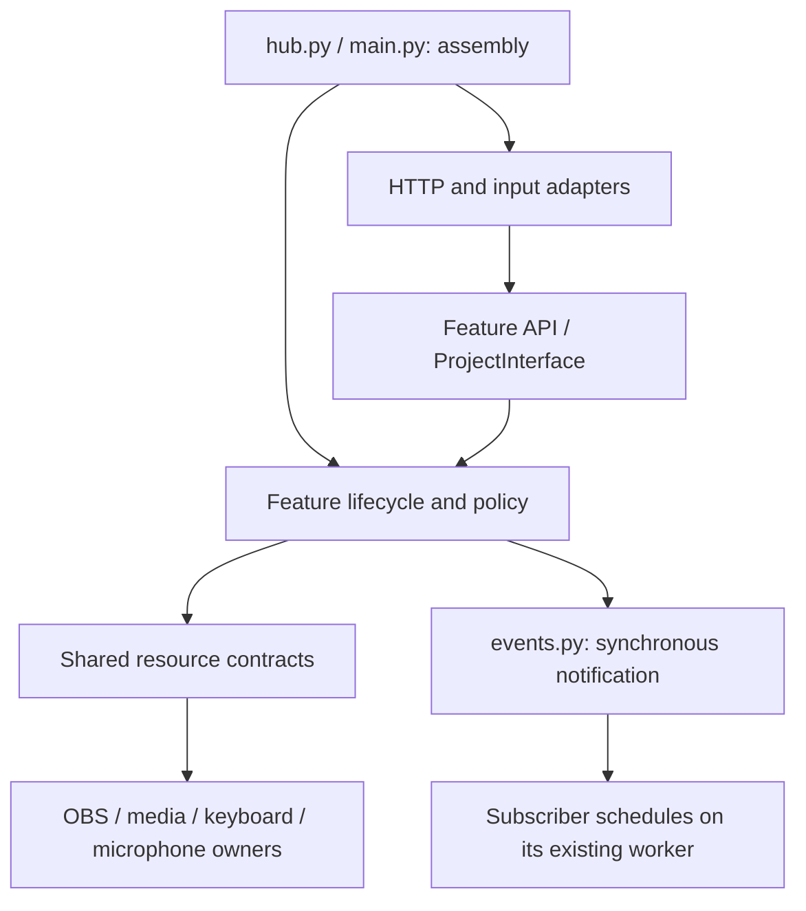

# Streaming Hub: navigation and control flow

Start here for a code change. [AGENTS.md](../AGENTS.md) protects personal data;
[CONTRIBUTING.md](../CONTRIBUTING.md) defines extension and verification rules.
The [responsibility reference](../ARCHITECTURE.md#shared-owners) records detailed
contracts. The [2026-10-15 audit](ARCHITECTURE-AUDIT-2026-10-15.md) records findings
and remaining work. This guide describes the supported v2 checkout.

## Find the owner first

| Change or question | Start here | Boundary to retain |
| --- | --- | --- |
| What starts and stops? | `hub.py`, `main.py`, `lib/hub_runtime/projects.py` | Assembly owns lifetime; feature policy stays in its package |
| Which features exist? | `lib/project_registry.py: SUPPORTED_RUNTIME_PROJECTS` | Disk discovery, not live state |
| What can a running feature do? | `lib/project_runtime.py: ProjectInterface`, feature `interface.py` / `api.py` | Public contracts; never borrow another feature's `_live` |
| Who can change the program scene? | `lib/coordination/scenes.py: SceneDirector` | Sole writer; revisions reject stale intent |
| Who may play or pause? | `lib/coordination/playback.py`, `pauses.py` | Request identity and scoped claims; manual choices retain ownership |
| How does temporary playback return? | `lib/coordination/scene_session.py` | Reserve before loading; return only while the lease remains valid |
| Who touches this physical media source? | `lib/shared_media/playback_worker.py`, `playback_controller.py`, feature `player.py` | One source worker through final cleanup |
| Where do per-asset settings live? | `lib/shared_media/single_source_state.py`, `lib/project_settings.py`, `hub_ui/audio.py` | Loaded asset owns filters/placement/gain; preserve unknown personal fields |
| How are settings written? | `lib/json_store.py`, feature settings owner | Whole read/modify/write transaction; snapshot before personal edits |
| How do features communicate? | `events.py`, project interfaces, `lib/coordination/game_policy.py`, `lib/twitch_clip_session.py` | Synchronous callbacks schedule promptly; provider tokens have lifetimes |
| Where does a browser action go? | `hub_ui/server.py`, `hub_ui/routes/`, `hub_actions.py` | HTTP validates/adapts; feature API owns behavior |
| Keyboard or microphone problem? | `lib/global_hotkeys.py`, `lib/keyboard_worker.py`, `voice/service.py`, `voice/ptt.py` | Shared owners; no extra native hook or microphone session |
| Encoding/decoder contention? | `lib/media_jobs.py`, `lib/asset_preparation.py`, `lib/media_metadata.py` | Shared admission and cache; feature owns cancellation |
| Why did a workflow wait or switch? | Stream map, `GET /api/coordination`, owner `workflows.json` | Observations explain decisions; they do not dispatch them |

`coordinator.py` and `shared.py` are compatibility facades. Follow their imports to
the implementation above; never create another singleton in a facade. The registry
is a directory of interfaces, not a resource reservation mechanism. Its status and
conflict queries can change immediately after they return.

## Dependency direction



Shared services do not import feature implementations. A declared HTTP composition
adapter may import the public API of the feature it exposes. Feature peers use
interfaces, scoped notifications or a shared provider contract. Arbitration is
centralized per shared resource; feature workers do their own work after admission.

## Startup and shutdown

1. `Run Hub.bat` launches this checkout's `hub.py`. `hub_instance` prevents a second
   Hub for this checkout. `hub.py` owns the application stop event.
2. `main.run_hub` configures environment/native budgets, binds shared services,
   discovers supported projects and installs saved coordination rules.
3. `lib/hub_runtime/projects.py` starts workers and waits for readiness. If OBS is
   unavailable, projects declaring `REQUIRES_OBS = False` start first. The deferred
   startup worker starts voice and the remaining projects after OBS connects.
4. Each feature's `run` assembles its engine, registers providers/subscriptions,
   publishes readiness, and observes the stop event. Imports define code only.
5. `hub.py` starts UI/editor and auxiliary services. Shutdown signals the stop
   event, joins projects/shared workers, and releases hooks/coordination. Feature
   `finally` paths release registrations and physical resources. Partial startup
   needs the same cleanup discipline as normal shutdown.

The Hub is one Python process with feature/shared workers and one keyboard child.
OBS is separate. Footage Desk (`footage_manager/app.py`) is another application and
does not participate in an unrelated Hub restart.

## Playback admission and cancellation

```mermaid
sequenceDiagram
    participant Input as Input / HTTP adapter
    participant Feature as Feature API
    participant Coord as PlayCoordinator
    participant Worker as Existing source worker
    participant Source as OBS / browser source
    Input->>Feature: Request action
    Feature->>Coord: request(owner, admitted)
    Coord->>Coord: Acquire owned pause claims / update gates
    Coord->>Feature: admitted(ticket)
    Feature->>Worker: Schedule request; return promptly
    Worker->>Worker: Check cancellation and ticket.allowed
    Worker->>Source: Load / play while permitted
    Worker->>Source: Final cleanup
    Worker->>Coord: ticket.finish()
    Coord->>Coord: Release only this ticket's claims
```

`PlaybackTicket` identifies one request. Completing an old request must not finish
its replacement. `PauseLedger` retains overlapping claims and preexisting/manual
pauses. Layered playback still observes its module permission gate. An admission
callback must not wait for playback or acquire a player lock held by a thread
waiting for the coordinator.

`PlaybackWorker` keeps one active request and one replaceable pending request.
Replacement cancels the active request and supersedes pending work; the next run
starts only after the active callback returns from cleanup. Owners must honor
cancellation between load stages, finish tickets in `finally`, and wait for owned
cleanup during shutdown. Signaling cancellation does not prove that a source is
free. See `tools/test_coordination.py`, `tools/test_cleanup.py` and
`tools/test_shared_state.py` for replacement/claim/persistence regression scenarios.

## Scene intent and temporary presentations

Feature policy chooses a destination; `SceneDirector.request` serializes its
acceptance, preparation and program-scene write. An automatic request can be held
or deferred. Only the latest deferred intent is retained. Delayed work passes the
revision captured when scheduled. Use manual revision when an intent may survive
a temporary presentation but must yield to a newer manual choice; use the full
revision when any intervening decision invalidates it.

A temporary presentation obtains `SceneSession` before loading. It activates only
while its lease is valid, may advance owned stages with `present`, and finishes in
`finally`. Manual choices, external scene changes and lost observation revoke
ownership. Cleanup cannot restore a stale remembered scene. Scoped pause claims
belong to that session and are released according to its ownership outcome.

Two fresh automatic requests have no universal feature priority: accepted order
can matter. Feature policy must coordinate semantic handoffs through the existing
contracts. A single scene writer prevents competing writes; it does not establish
all game-policy ordering by itself.

## HTTP, events and browser lifetimes

`hub_ui/server.py` composes route mixins. `routes/projects.py` dispatches generic
project actions and delegates feature endpoints; specific adapters such as
`routes/replay.py` call public feature APIs. They must not read `_live`, own capture,
or create a second player. `hub_ui/replay_trim.py` is a compatibility facade;
actual edit jobs belong to Instant Replay's `editing.py`.

`events.emit` copies subscribers under its lock and invokes them synchronously
after releasing it. A slow callback delays the emitter. Subscribers enqueue on an
existing bounded worker and unregister on shutdown. Observers are read-only and
must not dispatch business actions. `hub_ui/updates.py` adapts events to bounded
SSE queues; it is not another domain event bus.

Browser renderers own presentation and document cleanup, not game detection.
Reuse `lib/browser_effects/web/visible-poll.js` for cancellable visible-only reads.
Reject late responses and release subscriptions/frames/media on disposal. Several
features intentionally use their own local HTTP service; sharing the Hub process
does not put every transport or feature policy in `hub_ui/server.py`.

## Feature entry points

Supported runtime packages are enumerated by
`lib/project_registry.py: SUPPORTED_RUNTIME_PROJECTS`; avoid another discovery list.

| Feature family | Policy / public entry points | Presentation / data owners |
| --- | --- | --- |
| Soundboard, TikTok, SFX | Feature `interface.py`, `main.py`; generic `lib/shared_media/` | Existing source workers, profiles and asset state |
| Music / mood | `specific_song/commands.py`, `player.py`; `love_me/api.py`, `player.py` | Feature library/settings; `lib/audio_focus.py` and Spotify's `playback_control.py` for native music interruption |
| Replay | `instant_replay/api.py`, `capture.py`, `selection.py`, `playback.py` | `library.py`, `editing.py`, `stage.py`, `obs_stage.py` |
| League signals / scenes | `league/core/`, `league_api/main.py: Service`, `client_scenes.py`, `scene_routing.py` | `engine.py`, `production/`, `match_recording.py` and recording storage owners |
| League reports | `league_stats/collector.py`, `service.py`, `api.py` | Archive, report projections and `recap_show.py` |
| Lobby / starting | `scene_voice_switcher/api.py`, `screen_content.py`; `starting_soon/` | Saved layouts/artwork; shared scene sessions and lobby mechanics |
| Twitch | `twitch_commands/service.py`, `twitch_celebrations/`, `lib/twitch_redemptions/` | Shared `lib/twitch_chat.py` transport; feature authorization, policy and renderers |
| Spotify | `spotify/service.py`, `playback_control.py`, `music_focus.py` | Existing capture/analysis loop and browser presentation |

Feature paths in this table are relative to `mini projects/` unless prefixed by
`lib/`. Standalone exporters in `stream_brand/` and finite maintenance commands in
`tools/` are not Hub startup features. Generated `output/` diagnostics are not the
place to look for runtime policy.

## Verify a change and its explanation

Run architecture/workflow checks and relevant offline tests described in
[CONTRIBUTING.md](../CONTRIBUTING.md#verification-and-debugging). Shared infrastructure
changes require the full offline suite; browser `.cjs` tests are separate.
The architecture checker is a static guard, not proof that every race is absent.

The existing [Stream map](WORKFLOW-MAP.md) at `http://127.0.0.1:7420/#workflows`
provides navigable conditions, waits, ownership and cleanup, with source proofs and
recent observations. Review the owner-local manifest against code after behavior
changes; stamp only reviewed flow IDs. A stale proof means the explanation needs
review, even when tests pass. Do not clear that warning by bulk stamping.

Personal profiles, volumes, filters, transforms and replay locations are data.
Use external settings history before editing them. Runtime changes need a hidden
restart of this exact Hub and readiness/one-keyboard-child verification.
Documentation and offline checker changes do not require a runtime restart.
